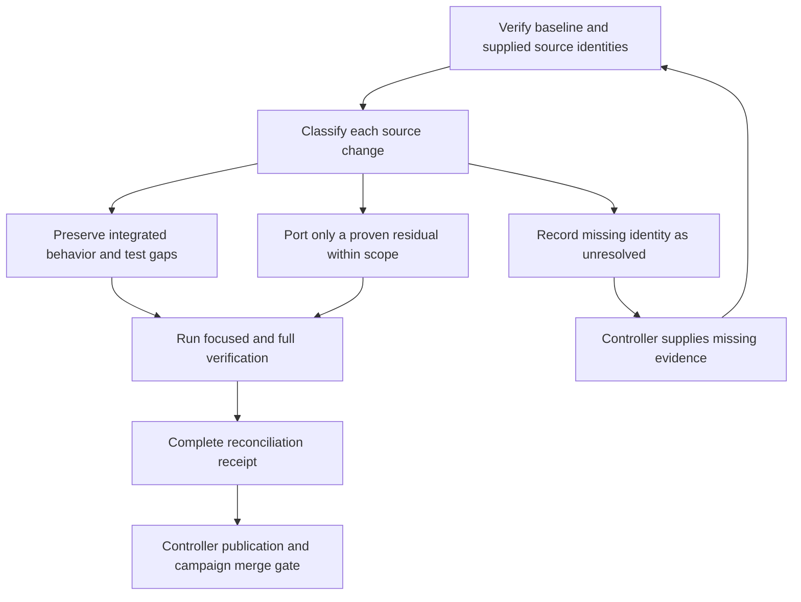

# Reconcile fp-1 search and release-preparation branches - Plan

## Goal Capsule

- **Objective:** Downstream FOLIO applications retain reliable label search, and maintainers can account for the work in all three named branches before closing the reconciliation item.
- **Means:** Compare source changes with the current baseline, preserve integrated behavior, and add focused regression evidence and a sanitized reconciliation receipt (KTD1–KTD4).
- **Authority:** The controller's `fp-1` mandate and standing rules; the chief repository's `docs/plans/2026-10-26-0705-feat-codex-drawdown-campaign-plan.md`, Goal Capsule and campaign R11, R15, R16, R17, R19, R20; this repository's `CLAUDE.md`.
- **Authority limitation:** The chief repository and `ops/drawdown/mandates/_common.md` are absent from this sandbox. The campaign text has not been read; campaign R-ID references here derive only from the supplied standing rules. The controller must supply the named excerpts before build authorization is treated as fully grounded.
- **Execution:** This stage produces and locally commits only this plan. The later build stage uses `lfg` on this plan; the controller scans, pushes, and opens the PR, and the campaign merge gate owns merging (R6).
- **Stop conditions:** Preserve R7's exclusions. Missing branch identity or verification evidence prevents a completion claim, with the controller dependencies identified below.

---

## Product Contract

### Summary

Reconcile `feature/case-insensitive-prefix`, `fix/altlabel-lang-search`, and `chore/u12-exec-20260930` against the verified baseline. Available history already contains the search implementations. The expected remaining work is deterministic regression coverage and a public-safe record of the release-preparation branch's disposition.

### Problem Frame

The mandate catalog did not run tests, and its branch list does not establish unfinished code. Squash merges obscure ancestry, old branches contain changes superseded by later work, and the local `main` ref is behind the supplied checkout. Treating those branches as unmerged features could regress search, restore obsolete dependencies, or reopen publishing work outside this mandate.

### Requirements

These R-IDs are local to this plan; references prefixed **campaign** identify the external campaign requirements.

**Source reconciliation**

- R1. Account for each named branch using a confirmed source tip, baseline identity, changed-file inventory, and evidence-based disposition; mark candidate-only comparisons as provisional.
- R2. Preserve the existing insensitive default, explicit sensitive mode, Unicode casefold matching, primary-label precedence, result deduplication, prefix-cache refresh clearing, and bounded search caches.
- R3. Preserve searchable language-tagged class alternative labels, their translation entries, and duplicate-text suppression.

**Proof and documentation**

- R4. Add focused tests for the reconciled search behavior and keep every existing test and assertion; actual MARISA and forced Python fallback execution both require evidence (campaign R15, R16).
- R5. Preserve useful residual U12 preparation facts in a dated, public-safe receipt that distinguishes source integration, local version tags, historical checks, and independently verified package publication.
- R6. Keep this item on `drawdown/fp-1`, commit locally, and return verification evidence to the controller without configuring a remote, seeking credentials, pushing, or opening a PR (campaign R15, R17, R19).

**Boundaries**

- R7. Exclude version bumps, package publishing, publisher setup, schema migrations, data rewrites, new services, spend, credential/security changes, sends in the user's voice, deletion, and force-push; never read prohibited credential material (mandate and campaign R11).
- R8. Report unavailable inputs and failed or blocked checks accurately; finish independent authorized work and route remaining dependencies to the controller without waiting for Damien (campaign R20).

### Key Decisions

- **No waiting for Damien through 2026-10-30.** Governs R8. (session-settled: user-directed — chosen over holding work for personal review: this campaign allocates zero user time during that period.)
- **Guarded expansion delivery remains settled.** Governs R6, R7. (session-settled: user-directed — chosen over holding expansions for personal review: the campaign merge gate owns acceptance.) This item remains `planned`; it does not authorize another expansion.
- **Exhausted work leads to durable hygiene.** Governs R1, R7. (session-settled: user-directed — chosen over speculative features: completing reconciliation is not permission to invent more scope.)

### Scope Boundaries

The work concerns class label-search reconciliation and its evidence. No frontend changes are proposed, so the screenshot requirement does not apply. Do not delete or retag source branches.

Do not redesign translation multiplicity, fuzzy-cache invalidation, failed-refresh recovery, short-label parity, or equal-rank tie ordering. None is needed to reconcile the observed source changes; a confirmed named-branch delta would be the evidence needed to reconsider scope.

#### Deferred to Follow-Up Work

Cache-pressure benchmarks belong to `fp-2`; structured-query examples belong to `fp-3`; broad type, coverage, and dependency audits belong to `fp-4`. PyPI delivery and its trusted-publisher prerequisite remain separately held under the repository mandate.

---

## Planning Contract

### Reverified Starting State

Read-only inspection on 2026-10-26 found a clean `drawdown/fp-1` checkout at `06557c913164c5a15ca4075d0fc274c09768f64a`. Local `main` and tag `v0.4.1` point to `35814e6e405c3a17d7a2240d8ea0efe7b4179461`. The checkout is two commits ahead: merge #22 and its handoff/formatting commit. Its difference from local `main` is one blank line in `folio/graph.py` and `docs/handoffs/2026-10-20-sweep-cloud-folio-python.md`.

The repository is not shallow, has no remote, and exposes none of the three named source refs. Source-related commits remain in the local object store. Their availability is evidence of historical content, not proof of today's branch tips. No tests or library runtime probes were run during planning.

| Source or baseline | Local evidence | Planning disposition |
| --- | --- | --- |
| `fix/altlabel-lang-search` | `303eb54063148dcb1ad282d640694a21aedad829` is identified by the October 20 handoff. The aggregate `32f9666^..303eb54` change and main's `b9a1a70` share stable patch ID `6bf1d28e36e0a6f153bd985b6236c37feb1e07dc`. | The observed fix is integrated. Confirm the current source tip before declaring the whole branch reconciled. |
| `feature/case-insensitive-prefix` | `caa7c8531af69e27ac0537a8f4fab8dc4065b9b5` contains an early implementation. Related histories end at `7e8b4a4a40446a974398fcc06cac5dfb573750be` and `50f3e315d2ce0abf1b6cd5a1764c00510a9513e4`; their exact mapping to the mandate branch is unverified. | Main includes `fe05fd4` (#16). Compare every confirmed source delta; do not substitute a related PR history for the named branch. |
| Prefix implementation in main | Source comparison of `fe05fd4` with HEAD shows identical parsing, refresh, and public prefix dispatcher bodies. Both prefix search helpers differ only in their later bounded-cache storage calls. | Preserve main's implementation and #20 cache bounds; add missing behavioral evidence. |
| `chore/u12-exec-20260930` | Candidate `8bd27dfc6ca2ef380950530671eb08087304da20` follows `e96de9ac288fc65a8565c4fbb2fa986aa2f15b6b`. Relative to common ancestor `1b4fb34`, they add only a release plan and execution note. | Retain useful history through R5's receipt; raw documents contain obsolete publication steps and machine-local paths. |
| Release markers | `b9a1a70` is contained by local `v0.3.4` and later tags; `fe05fd4` by `v0.3.5` and later; `1b4fb34` by `v0.4.1`. | These establish tagged source inclusion, not successful PyPI delivery. |

### Key Technical Decisions

- KTD1. **Reconcile changes individually.** Use ancestry, aggregate patch equivalence, and source comparison together to satisfy R1. A whole-branch merge or cherry-pick would carry superseded material; the related `7e8b4a4` tree lacks structured-query code and tests present in main and includes old release metadata. Preserve the supplied checkout and never reset it to the older local `main`.
- KTD2. **Use deterministic parser-to-search regressions.** Add `tests/test_search_reconciliation.py` with function-local graphs and a controlled RDF/XML loader. This proves R2–R4 through the real parser and public search API without relying on external ontology contents. Keep all existing integration tests.
- KTD3. **Prove each backend separately.** Construct fresh graphs after selecting real MARISA or forced fallback, with isolated caches. Require a real imported backend and constructed tries for the MARISA cases; absence is incomplete verification. Limit parity claims to the specified fixtures, whose labels have at least three characters and no ambiguous sorting ties.
- KTD4. **Consolidate historical U12 evidence.** Create `docs/plans/evidence/fp-1-branch-reconciliation.md` rather than importing the old files verbatim. Cite their source commits and repo-relative paths, preserve dated outcomes and limitations, and mark publication instructions as outside R7. No historical check becomes a current acceptance result.
- KTD5. **Use baseline-relative verification.** Run checks on the unchanged checkout before implementation, then on the final change in the same environment. The historical `CLAUDE.md` count of 47 type diagnostics and older handoff test counts are context only. Acceptance requires fresh results and no new diagnostics attributable to this item.
- KTD6. **Use Astra for this lane's agent work.** (session-settled: user-directed — chosen over the Sol-first ladder: the campaign fixes the model choice.)

### Behavior and Test Design

Construction loads OWL, parsing records language-tagged alternatives in both translations and the searchable label list, and indexing feeds the original-case and casefold search paths. Successful refresh clears class indexes, loads fresh XML, and reparses it, clearing both prefix caches. The new tests exercise that existing lifecycle.

| Mode | Real MARISA case | Forced fallback case |
| --- | --- | --- |
| Default insensitive | Query `STRASS` matches alternative label `Straße` once. | Same exact IRI outcome on a newly constructed graph. |
| Explicit sensitive | `Straß` matches; `STRASS` does not. | Same case distinction on a newly constructed graph. |
| Successful refresh | Warm hits and misses in both caches, replace XML, and verify new results. | Same transition without trie construction. |

### Assumptions and Controller Dependencies

- **Before build:** The controller supplies the campaign Goal Capsule and cited R-ID excerpts. The provided standing rules are the current planning input; the unmounted chief plan has not been reconstructed from them.
- **Before definitive source reconciliation:** The controller supplies a dated mapping from each of the three branch names to its full tip SHA, plus the target `main` SHA and missing objects if needed. This requires controller repository evidence, not a user login or worker credentials.
- **Unvalidated expectation:** The observed candidates represent the material remaining work. The build must recompare confirmed tips; this plan does not assert that unseen commits contain no residual behavior.
- **Execution-time uncertainty:** Dependency availability, fresh test outcomes, and current type diagnostics are unknown. The controller must provide a suitable runner for any blocked integration checks before acceptance.

### Sources

Current implementation and tests: `folio/graph.py`, `folio/models.py`, `tests/test_folio.py`, `tests/test_iri.py`, `pyproject.toml`, `CLAUDE.md`, and `CHANGES.md`. Historical context: `docs/handoffs/2026-10-20-sweep-cloud-folio-python.md`. Candidate U12 artifacts: `docs/plans/2026-09-30-release-delivery-reconciliation.md` at `e96de9a`, and `agents/run-notes/u12-exec-folio-python-20260930.md` at `8bd27df`; these paths are absent from the current tree.

---

## Implementation Units

### U1. Establish the source disposition and preserve useful U12 evidence

**Goal:** Give each named branch a traceable disposition without restoring superseded work.

**Requirements:** R1, R5–R8; KTD1, KTD4, KTD6.

**Dependencies:** The campaign excerpt is a build prerequisite; exact source identities are required to complete this unit's definitive comparison.

**Files:** Create `docs/plans/evidence/fp-1-branch-reconciliation.md`; read the current and historical sources listed above.

**Approach:**

1. Record the supplied checkout, target main, source tips, comparison time, and any divergence from this plan's snapshot.
2. Inventory each source change and classify it as already integrated, superseded, remaining within scope, or unresolved; attach commit and patch/content evidence.
3. Preserve the useful U12 preparation outcome with its original source and date, distinguish its limited tests from current validation, and explain why old release instructions are excluded under R7.

**Patterns to follow:** The October 20 handoff's separation of code integration from package delivery, with KTD4's sanitization.

**Test expectation:** None for this documentation unit; verify provenance, relative paths, and every disposition against source evidence. Do not add tests that merely assert receipt wording.

**Verification:** All three rows have confirmed identities and supported dispositions, or explicitly name the controller input still preventing closure. The receipt contains no machine-local paths or publication commands.

### U2. Prove the reconciled search behavior with isolated fixtures

**Goal:** Protect the named branches' user-visible search behavior with deterministic regression tests.

**Requirements:** R2–R4, R7; KTD2, KTD3, KTD5, KTD6.

**Dependencies:** U1's available-content comparison and unchanged-source baseline checks. Missing branch-tip confirmation does not prevent these independently justified tests after the campaign excerpt is supplied.

**Files:** Create `tests/test_search_reconciliation.py`. Modify `folio/graph.py` only for a confirmed, in-scope residual demonstrated by a failing regression. Existing `tests/test_folio.py` and `tests/test_iri.py` remain validation inputs.

**Approach:** Use a loader replacement installed before construction, compatible with the existing static loader's arguments, to supply a small RDF/XML graph and its refresh replacement. Follow KTD3's backend isolation. Reuse main's implementation unless a confirmed source delta and regression establish missing behavior; record any such delta in U1's receipt.

**Execution note:** Add characterization coverage before changing search code. An already-integrated implementation should pass the new tests without a production edit.

**Patterns to follow:** `FOLIO.parse_owl_class`, `FOLIO.parse_owl`, `FOLIO.refresh`, and the existing prefix tests in `tests/test_folio.py`. The deterministic loader fixture is a planned addition, not an existing repository fixture.

**Test scenarios:**

1. Parse an alternative label `Straße` repeated with and without a German language tag; its translation is preserved, its text occurs once in `alternative_labels`, and its class is indexed.
2. Query `STRASS` using the default mode and obtain exactly the expected IRI once; explicit sensitive `Straß` succeeds while sensitive `STRASS` returns no match.
3. Use a longer primary-label match and a shorter alternative-only match for the same prefix; the primary-label class comes first and duplicate matches produce each IRI once in both case modes.
4. Warm both sensitive and insensitive caches with an existing hit and a future match that currently misses. Refresh from replacement XML changing primary and alternative labels; removed labels no longer resolve, and formerly missing labels return the new expected IRI.
5. Execute scenarios 1–4 with real MARISA and with the module backend disabled before fresh construction. Repeated cached calls retain the same public results; require evidence that the two backend cases actually differ.

**Verification:** Focused tests pass in both backend cases without ontology network access. Existing search, preferred-label, structured-query, cache-bound, and IRI tests remain intact. Any source edit is the minimum needed for a demonstrated residual and retains the v0.4.1 bounds.

### U3. Complete acceptance evidence for controller delivery

**Goal:** Give the controller enough evidence to publish and review this item without a user decision.

**Requirements:** R1, R4–R8; KTD5, KTD6.

**Dependencies:** U1's confirmed comparison and U2's completed tests; preserve partial evidence if an external prerequisite remains unavailable.

**Files:** Update `docs/plans/evidence/fp-1-branch-reconciliation.md` with actual verification results.

**Approach:** Record the baseline and final source identities, check results, review disposition, and any controller rerun dependency. Check the final diff against R7 and ensure source/test changes are limited to demonstrated reconciliation work. Leave publication to R6's owner.

**Test expectation:** Run the Verification Contract; this unit adds no separate behavioral tests.

**Verification:** The receipt supports every completion claim and distinguishes a locally complete artifact from an item still awaiting source confirmation or integration verification.

---

## Verification Contract

These are build-stage checks, not results from planning. Use the same dependencies and ontology/cache provenance for baseline and final runs wherever possible.

| Check | Scope | Acceptance evidence |
| --- | --- | --- |
| Source comparison | U1 | Confirmed branch-tip and main SHAs; complete delta disposition; no guessed branch mapping. |
| Focused regressions | U2: `uv run pytest tests/test_search_reconciliation.py` | All scenarios pass with verified real-MARISA and forced-fallback execution; fixture loading uses no external ontology. |
| Fast existing suite | U2–U3: `uv run pytest tests/ -k "not benchmark"` | Baseline and final outcomes recorded; no new failures and all required existing assertions retained. |
| Full suite | U3: `uv run pytest tests/` | Existing tests, including benchmarks, pass on a suitable runner. This does not add fp-2 endurance benchmarks. |
| Lint and format | U3: repository-prescribed Ruff check and format commands in `CLAUDE.md` | Clean results; any autoformatting outside the focused change is reviewed for scope. |
| Types | U3: `ty check folio/` | Fresh baseline comparison shows no new item-caused diagnostics; inherited failures are named, not silently waived. |
| Final artifact review | U1–U3 | Public-safe prose, repository-relative paths, focused diff, and no excluded release, dependency, or security mutation. |

Network, dependency, or sandbox failures are incomplete verification. Record the command, environment constraint, and required controller rerun; do not skip or weaken existing tests to report green. The October 20 handoff's historical outcomes do not satisfy this contract. No screenshot is required for the proposed non-frontend work.

---

## Definition of Done

- Each of the three named branches has a confirmed, evidence-backed disposition under R1.
- Remaining in-scope work is integrated with passing regression coverage; already-integrated behavior is preserved under R2–R4.
- The receipt preserves useful U12 history and clearly separates it from current validation under R5.
- All applicable verification gates have current evidence, including any controller rerun required by the sandbox.
- The committed diff contains only the plan, focused reconciliation work, tests, and evidence; abandoned experimental changes are absent, and unrelated work is preserved.
- The worker reports the local commit, branch, plan path, and any unresolved controller dependency under R6–R8. Source reconciliation is not declared complete while those acceptance dependencies remain open.
