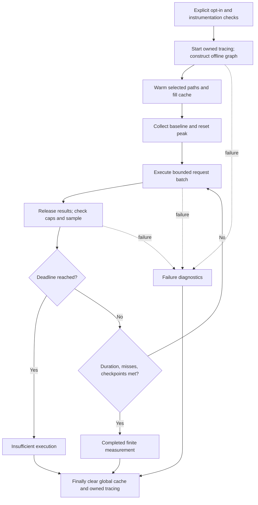

# Sustained search-cache pressure benchmarks - Plan

## Goal Capsule

- **Objective:** Maintainers can reproduce evidence showing whether v0.4.1 search caches retain their limits and correct results during sustained query churn.
- **Means:** Offline correctness checks and opt-in continuous pressure measurements, following KTD1-KTD5.
- **Scope:** Mandate item `fp-2`, an expansion, on `drawdown/fp-2` only.
- **Authority:** The chief repository's `docs/plans/2026-10-26-0705-feat-codex-drawdown-campaign-plan.md`, its cited campaign R-IDs, the supplied mandate, and this repository's `CLAUDE.md` govern the work. Local R-IDs below are distinct from campaign R-IDs.
- **Execution and delivery:** This stage commits the plan only. The later build stage implements, simplifies, reviews, verifies, and commits locally. The controller scans, pushes, and opens the PR; the campaign gate merges it under campaign R15/R19. The clone has no remote or GitHub login by design; do not add either or discover credentials.
- **Stop conditions:** Honor campaign R11 and the supplied hard stops: no spend, credential/security changes, sends in the owner's voice, deletion without verified backup, or force-push. Do not read credential files, `.env*`, `*.pem`, `*.key`, or secret directories. Owner-only blockers use the campaign R20 decision format; none is currently needed for this item.

**Authority limitation:** The chief repository and named campaign plan were unavailable in this sandbox. Its Goal Capsule and cited R-ID text have not been read. The controller must cross-check those sections before assigning the build; the supplied standing rules are the available authority for this local plan. This is a controller source-check prerequisite, not an owner decision.

---

## Product Contract

### Summary

Add reproducible long-running benchmarks for the existing search-cache bounds, with fast default tests and an explicit opt-in for sustained measurements. Publish inspectable, public-safe evidence about cache occupancy, correctness, retained Python allocations, and instrumented batch timing.

### Problem Frame

Downstream applications can keep a FOLIO graph alive across many searches. Existing coverage in `tests/test_folio.py::test_search_caches_are_bounded` checks three 128-entry limits after 129 no-match queries. The existing search benchmarks repeatedly search fixed terms. These establish a useful boundary check and warm-query measurements, but do not demonstrate sustained eviction with result-bearing requests.

Static starting-state inspection found clean branch `drawdown/fp-2`, HEAD `06557c9`, package version `0.4.1`, and bounded-cache commit `1b4fb34` already present. No tests or benchmarks ran during planning; current pass/fail and achievable throughput remain unknown.

### Requirements

**Compatibility and measurement**

- R1. Preserve production code, existing tests and benchmarks, package version, dependencies, CI workflows, and default coverage options; add only fp-2 test tooling, documentation, and evidence.
- R2. Construct an isolated, deterministic offline ontology through the real parser, preventing network loading and optional LLM initialization while exercising real search dependencies.
- R3. Verify the exact 128-entry contract, actual miss progression, FIFO/LRU eviction distinctions, hot reuse, and result parity across both prefix modes and public label/definition searches.
- R4. Run three explicit opt-in long scenarios with one continuous measured invocation each, accepting evidence only when the declared duration, miss, checkpoint, and deadline conditions are met.
- R5. Bound retained measurement data and report Python-traced memory and instrumented batch timing as observations with their limitations.

**Contributor workflow and evidence**

- R6. Keep short tests enabled by default and skip only the new marked long cases without opt-in; test gate behavior, failure cleanup, and invocation semantics without minute-long harness tests.
- R7. Document reproduction and retain JSON-safe public evidence from actual runs, distinguishing successful measurements from assumptions, failures, and missing execution.

### Key Decisions

- **Guarded expansion delivery** (session-settled: user-directed — chosen over holding expansions for owner review: the campaign authorizes expansion delivery behind its guardrails). Governs R1 and the Goal Capsule delivery route.
- **Mandate boundary** (session-settled: user-directed — chosen over speculative features after mandate exhaustion: subsequent work becomes durable hygiene). Governs R1; this plan authorizes no subsequent item.

### Scope Boundaries

R1 excludes cache redesign, runtime API changes, version bumps, PyPI publishing, schema migrations, data rewrites, new outside services, frontend work, and the other folio-python mandate items.

Considered and not built: a new benchmark framework, automated nightly service, and hardware-specific pass/fail thresholds. Existing pytest tooling and finite local measurements serve this item; repeated evidence of a concrete unmet need would justify reconsidering them separately.

Entry counts do not establish an absolute process-memory bound, native-allocation guarantee, latency service level, or unlimited-duration leak guarantee. Payload sizes, other cached helpers, and unrelated application state remain outside the measurement claim.

---

## Planning Contract

### Key Technical Decisions

- KTD1. **Use isolated fixtures with normal construction.** Generate fixed-size RDF/XML, monkeypatch `FOLIO.load_owl` to return it, and disable `folio.graph.alea_llm_client` within the fixture scope. Normal construction exercises `parse_owl`, indexes, and tries. `use_cache=False` alone still fetches data. Include nonempty definitions and use fresh graphs; clear the process-global fuzzy cache before and after each case, including failures.
- KTD2. **Measure three cache identities.** Use sensitive-prefix FIFO, insensitive-prefix FIFO, and mixed public label/definition LRU scenarios. Prefix caches are per-instance and reads do not promote recency. Insensitive keys use `casefold`. Static `_basic_search` shares one LRU across graph instances, with query, corpus tuple, limit, and scorer type contributing to its keys. Count fuzzy misses from cache-info deltas and prefix misses from actual normalized-key absence immediately before sequential calls. Record hits and result-bearing requests separately. Short tests cover trie/fallback parity; long runs use the real installed trie backend.
- KTD3. **Control invocation and measurement boundaries.** Start tracing before graph construction, explicitly warm the exercised paths, fill the selected cache, then take the baseline and reset traced peak. Keep one graph and its caches throughout measured churn. Use one pedantic round, default one iteration, zero implicit warmup, and no cProfile; verify exact invocation count against the locked plugin with a cheap target before relying on it. Reject incompatible disabled/profiled measurement modes. Each scenario completes one interval without calibration-driven repeats.
- KTD4. **Separate strict invariants from observations.** Assert cache limits and result correctness. Report memory deltas and batch timing without guessed byte or latency gates. Keep normal GC enabled during workload execution; use equivalent explicit collection before baseline and memory samples, outside batch timings. Release each result before sampling. The wrapper rejects pre-existing tracing and stops only tracing it started. Finalization clears the global cache even after preparation or measurement failure.
- KTD5. **Retain bounded, public evidence.** Stream request keys and keep counters, fixed-size summaries, and a fixed bound on checkpoints. Do not retain per-request results, keys, timings, or snapshots. Format output after measurement. Use an allowlisted JSON schema for committed evidence; raw plugin JSON can contain host metadata and is not a publication artifact. A failed or insufficient run emits concise elapsed/miss/checkpoint diagnostics even if plugin JSON is absent.
- KTD6. **Use the campaign's Astra route** (session-settled: user-directed — chosen over the Sol-first ladder: the campaign selected Astra for this work).
- KTD7. **Resolve technical choices without an owner wait** (session-settled: user-directed — chosen over waiting for owner input: no owner time is available through 2026-10-30). Record true owner-only blockers under campaign R20; the proposed work currently needs none.

### Assumptions

These are engineer-selected defaults, not measured results or user-specified thresholds:

- A long scenario requires at least **60 measured seconds**, **12,800 measured cache misses** after baseline, and **10 checkpoints**, all completed before a **180-second cooperative deadline**. This is 100 capacity equivalents for the selected 128-entry cache; the mixed fuzzy scenario counts one shared cache.
- The fixed-size fixture supplies more than 128 positive-match prefix keys, alternate labels, mixed case, nonempty definitions, and fixed-width cold queries. A deterministic cold-key cycle larger than capacity is acceptable when measured absence proves misses; global uniqueness is unnecessary.
- Requests mix cold traffic and an explicit hot set. Batch size and checkpoint cadence remain implementation details, provided they support the required checkpoints with bounded overhead and retention.
- Three successful scenarios require at least three minutes of measured workload plus preparation. Check deadlines at bounded batch boundaries; one batch may overrun, but a late batch cannot turn a deadline failure into success.

Do not silently reduce these acceptance defaults when a run cannot meet them. Report insufficient execution with the effective configuration and counters. Short tests inject clocks and smaller work budgets into the same runner.

### Measurement Flow

### Research and Compatibility

`folio/graph.py` supplies the ownership and eviction behavior above; `CHANGES.md` records the motivation for bounding unique-search retention. `tests/test_folio.py` supplies cache cleanup and fallback-monkeypatch patterns; `tests/test_iri.py` is a precedent for a separate offline test module.

Python's [tracemalloc reference](https://docs.python.org/3.10/library/tracemalloc.html) distinguishes current and peak traced allocations and excludes allocations made before tracing. That supports KTD3/KTD4 and limits the memory claim. Python's [timing guidance](https://docs.python.org/3.10/library/timeit.html) describes GC and external-noise effects; instrumented batch timings are diagnostic, not a latency guarantee.

[pytest's opt-in example](https://docs.pytest.org/en/stable/example/simple.html#control-skipping-of-tests-according-to-command-line-option) supports marker-specific gating. The [pytest-benchmark pedantic reference](https://pytest-benchmark.readthedocs.io/en/v5.1.0/pedantic.html) and [v5.1.0 fixture source](https://raw.githubusercontent.com/ionelmc/pytest-benchmark/v5.1.0/src/pytest_benchmark/fixture.py) support controlled invocation, with extra calls possible under profiling. The [pytest-cov v7.0.0 source](https://raw.githubusercontent.com/pytest-dev/pytest-cov/v7.0.0/src/pytest_cov/plugin.py) verifies `--no-cov` disables its measurement.

`uv.lock` resolves pytest **9.1.1**, pytest-benchmark **5.2.3**, and pytest-cov **7.1.0**. Researched earlier-version behavior does not prove every locked-version detail; U2 verifies the invocation and coverage controls. No dependency update is part of this plan.

---

## Implementation Units

### U1. Add isolated workloads and fast contract tests

**Goal:** Make sustained cache pressure and correctness testable without network data.

**Requirements:** R2, R3, and failure cleanup in R6; KTD1, KTD2, KTD4, KTD6, KTD7.

**Dependencies:** Controller campaign-source cross-check; otherwise none.

**Files:** Create `tests/test_cache_pressure.py`.

**Approach:** Add a compact fixture factory, deterministic request generator, and shared runner. Separate preparation, measurement, sampling, and finalization. Follow the existing cache-clear and monkeypatch patterns without using the network-backed module fixture. Keep production code unchanged.

**Execution note:** Establish fast characterization coverage before adding the long interval.

**Test scenarios:**

1. Check occupancy immediately before capacity, at capacity, and after repeated overflow; selected caches remain at most 128 entries.
2. Cold requests increase actual misses while repeated hot requests reuse entries; case variants reuse the same insensitive key.
3. Reading an older prefix entry does not prevent FIFO eviction, while fuzzy reuse promotes an LRU entry.
4. Known expected IRIs, order, deduplication, and fuzzy results match before eviction and after recomputation, including nonempty results.
5. Both prefix modes agree across trie/fallback paths, and public label/definition traffic competes for the shared fuzzy cache.
6. Inject preparation and workload failures; global caches and owned instrumentation are cleaned up without disturbing restored patches.
7. Inject clocks and small budgets to distinguish valid completion, hit-only work, insufficient turnover, and deadline precedence.

**Verification:** Focused short tests pass, fixture construction performs no hidden loading/provider work, and existing tests are unchanged.

### U2. Add gating, continuous measurements, and evidence output

**Goal:** Make opt-in long measurements finite, reproducible, and distinguishable from smoke coverage.

**Requirements:** R4-R6 and the measurement portion of R7; KTD2-KTD7.

**Dependencies:** U1.

**Files:** Extend `tests/test_cache_pressure.py`; create `tests/conftest.py`; register the marker only in `pyproject.toml`.

**Approach:** Register `cache_pressure` and `--run-cache-pressure`, skipping only marked items without the flag. Add the three KTD2 scenarios and the shared outcome/report format. Use the existing benchmark plugin and its `extra_info` output for bounded measurements; document temporary raw JSON output separately from the sanitized record.

The report includes scenario/backend, dataset dimensions, cache capacity, effective criteria, elapsed time, request/hit/miss counts, result-bearing counts, turnovers, checkpoint count, bounded early/late batch summaries, traced current/peak bytes, and completion outcome. Whole-target timing is harness duration, not request latency.

**Test scenarios:**

1. Miniature marked/unmarked pytest cases skip only marked cases by default and execute both with opt-in; test the actual gate code using built-in pytester support.
2. A harmless target under the locked plugin executes exactly once with the selected pedantic settings; profiled/disabled modes cannot yield accepted evidence.
3. Pre-existing tracing and incompatible instrumentation fail clearly; verify `--no-cov` actually disables the installed plugin's collection.
4. A long scenario satisfies all completion conditions together, or fails with bounded elapsed/miss/checkpoint diagnostics.
5. Reports remain bounded and JSON-safe, use explicit units, exclude host/private fields, and distinguish missing/skipped/insufficient runs from successful measurements.

**Verification:** Short harness checks pass before real long runs. All three long scenarios complete the declared pressure contract; incomplete execution remains a verification gap.

### U3. Document reproduction and retain measured evidence

**Goal:** Let another maintainer reproduce and correctly interpret the completed measurements.

**Requirements:** R1, R7; evidence from R2-R6 and KTD5-KTD7.

**Dependencies:** U2 and actual completed measurements.

**Files:** Create `docs/benchmarks/cache-pressure.md` and `docs/plans/evidence/fp-2-cache-pressure.json`.

**Approach:** Document the smoke, all-scenario, and single-scenario invocations; actual fixture dimensions and request mix; warmup boundary; GC policy; checkpoint retention; and measurement limits. Derive the public evidence record from real run output, including schema version, public revision, interpreter/tool versions, and U2 measurements. Keep usernames, hostnames, machine paths, environment dumps, raw data, and credentials out of the record.

**Patterns:** Follow repository Markdown documentation and KTD5's allowlist. Ordinary documentation needs no generated site or frontend change.

**Test expectation:** No separate prose-only unit test; U2 owns serialization and public-field checks. Verify documented commands against actual build-stage runs and inspect the resulting artifact.

**Verification:** The document and sanitized record agree on parameters, units, revision, tool versions, and completed outcomes. Smoke success and full-suite results remain separately identified.

---

## Verification Contract

These checks belong to the later build stage; none ran during planning.

| Verification | Method | Acceptance |
|---|---|---|
| Fast contracts | `uv run pytest tests/test_cache_pressure.py` | Short tests pass; only new long cases skip. |
| Harness controls | U2's miniature pytest tests | Gate specificity, single invocation, cleanup, instrumentation, and report semantics are demonstrated. |
| Long pressure | `uv run pytest tests/test_cache_pressure.py -m cache_pressure --run-cache-pressure --no-cov` | Three completed scenarios satisfy R4 with inactive coverage/profiling. |
| Existing behavior | `uv run pytest tests/` | Existing tests and benchmarks keep passing; new long cases remain gated. |
| Lint and format | `ruff check folio/ tests/` and `ruff format --check folio/ tests/` | Clean final changes. |
| Types | `ty check folio/` | No new diagnostics against a freshly recorded baseline; `CLAUDE.md` documents 47 historical diagnostics. |
| Evidence | Review U3 document and JSON | Public-safe data corresponds to actual completed runs, with consistent units and provenance. |

Recheck the starting state in the build stage before editing. Existing tests can depend on network-loaded ontology data; record environmental failures accurately and leave the tests intact. A blocked full-suite run is not a full-suite pass and remains visible to the controller's merge gate.

Inspect selected node IDs and run outcomes: skipped cases, zero selected cases, disabled benchmark statistics, missing scenarios, and expired runs cannot satisfy R4. Preserve default coverage outside the explicit performance invocation. Do not expand into the existing CI/toolchain mismatch or unrelated typing gaps.

---

## Definition of Done

U1-U3 satisfy R1-R7: fast contract tests pass, all three real long scenarios complete the declared pressure interval, and documented commands plus sanitized evidence accurately describe those runs.

The final diff preserves existing behavior/tests, contains no abandoned experimental code, and stays within R1. The controller receives verification limits and the campaign-source cross-check prerequisite. No screenshot is required because this item changes no frontend. This plan makes no claim that implementation, tests, or measurements have already completed.
