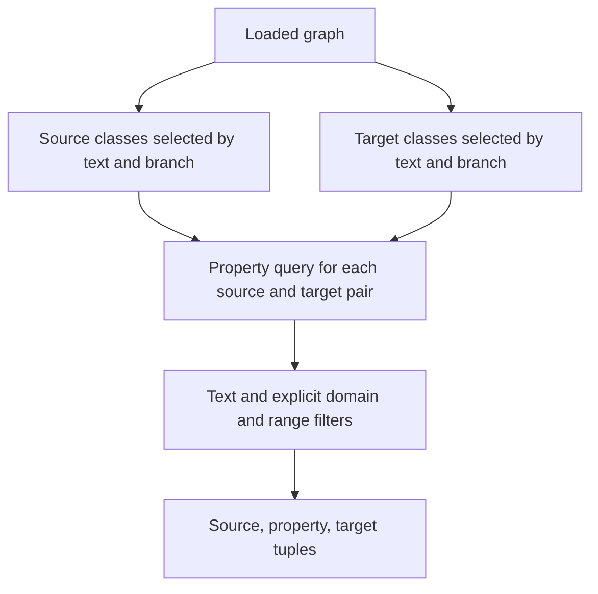

# Test-backed structured-query examples for fp-3 - Plan

## Goal Capsule

- **Objective:** Downstream FOLIO developers can combine text, branch, and property filters from examples whose behavior they can verify.
- **Means:** Add executable recipes, deterministic tests, and explanations in the existing README (KTD1–KTD4).
- **Authority:** The controller's `fp-3` mandate and standing rules; the chief repository's `docs/plans/2026-10-26-0705-feat-codex-drawdown-campaign-plan.md`, Goal Capsule and campaign R11, R15, R16, R17, R19, R20; this repository's `CLAUDE.md`.
- **Authority limitation:** The chief repository and `ops/drawdown/mandates/_common.md` are not exposed in this sandbox. Their contents have not been read. Campaign R-ID references below come from the supplied standing rules; the controller must supply the named excerpts before the build is treated as fully grounded.
- **Execution:** This stage commits this plan only. The later build stage runs `lfg` on it, with local commits only; the controller publishes and the campaign merge gate owns merging under R5.
- **Stop conditions:** R6 governs prohibited changes. Missing authority or verification evidence remains an explicit controller dependency under R7; no successful execution is inferred from source inspection.

---

## Product Contract

### Summary

Expand the existing Structured Queries documentation with three tested recipes: class text plus branch filtering, property text plus declared endpoints, and a composition that finds properties between selected classes. Keep the library's query behavior unchanged.

### Problem Frame

The README already demonstrates individual structured filters, but it does not show how class selections connect to property queries. Readers must infer whether branch membership implies property applicability, what multiple filters mean, and whether limited results are complete. Existing tests cover several query options against a live ontology; they do not directly execute shared composition examples against fixed data.

### Requirements

Local R-IDs belong to this plan. **Campaign** prefixes refer to the external campaign requirements.

**Examples and documentation**

- R1. Provide examples combining class text and branch filters, property text and domain/range filters, and both query methods in one class-to-property workflow.
- R2. Explain each example's inputs, returned objects, empty-result behavior, and relevant filtering/limit semantics without promising inference, ranking, or exhaustive results.
- R3. Back every added or changed runnable recipe with a test or doctest; retain a traceable test mapping for the existing Structured Queries examples.

**Compatibility and delivery**

- R4. Add coverage without deleting or weakening existing tests, and preserve existing public API behavior and dependency/package configuration (campaign R15, R16).
- R5. Keep this expansion on `drawdown/fp-3`, commit locally, and let the controller scan, push, and open its PR for the campaign merge gate (campaign R15, R17, R19). Never add a remote or seek credentials in this lane.
- R6. Exclude version bumps, PyPI/publisher work, schema migrations, data rewrites, new outside services, spend, credential/security changes, sends in the user's voice, unbacked deletion, and force-push. Never read prohibited credential material (mandate and campaign R11).
- R7. Report missing inputs and blocked checks accurately, complete independent authorized work, and route controller dependencies without waiting for Damien through 2026-10-30 (campaign R20).

### Key Decisions

- **Expansions merge through guardrails.** Governs R4, R5, R6. (session-settled: user-directed — chosen over holding expansions for personal review: the campaign merge gate owns acceptance.)
- **No waiting for Damien through 2026-10-30.** Governs R7. (session-settled: user-directed — chosen over waiting for personal input: the campaign allocates zero user time during that period.)
- **Durable hygiene follows exhausted mandate work.** Governs R1, R6. (session-settled: user-directed — chosen over speculative features: finishing this item does not authorize another feature.)

### Scope Boundaries

Active work is limited to `README.md`, a new `examples/structured_queries.py`, a new `tests/test_structured_query_examples.py`, and the two inaccurate `query()` docstring statements in `folio/graph.py`. No frontend changes are involved, so no Playwright screenshot is required.

A new query DSL, native joins, inferred domain/range applicability, sorting, pagination, and nonpositive-limit validation are not part of this item. The existing APIs support the requested examples; a demonstrated inability to express a required recipe would justify reconsidering scope. A separate cookbook page and generic Markdown execution harness would duplicate the README and recipe tests without closing an additional requirement.

#### Deferred to Follow-Up Work

Branch reconciliation belongs to `fp-1`, cache-pressure benchmarks to `fp-2`, and broad type/coverage/dependency audits to `fp-4`. Publishing remains separately held under the mandate.

---

## Planning Contract

### Reverified Starting State

Source inspection on 2026-10-26 found a clean `drawdown/fp-3` checkout at `94f1b29d2e7ea0dcd417b14f0d464bb8e53a0617`, with no remote configured. Local `main` points to `35814e6e405c3a17d7a2240d8ea0efe7b4179461`; it is not evidence of the controller's current target tip. Preserve the supplied checkout and recheck it before building.

- `README.md` already has Structured Queries examples for text plus branch, regex labels, leaf descendants, and inverse properties. No structured-query example module exists.
- `folio/graph.py` implements both query methods. Class and property filters can be composed by passing selected class IRIs into property queries; no runtime API addition is needed.
- `tests/test_folio.py` contains structured-query integration coverage, but its graph fixture constructs `FOLIO()` against external ontology data.
- `tests/test_search_reconciliation.py` provides an existing pattern for replacing `FOLIO.load_owl` before construction and disabling the optional LLM client. Its backend parametrization belongs to search reconciliation and need not be copied.
- `pyproject.toml` excludes `examples` from both wheel and sdist. Repository examples must not be presented as imports supplied by a package installation.

No tests or library runtime probes ran during planning. After fetching the declared development dependencies, Ruff lint and formatting checks passed on the unchanged `folio/` and `tests/` sources. A fresh `ty check folio/` run reported 47 diagnostics in those unchanged sources; the type check is not clean. These static checks do not establish runtime correctness, and the build must capture its own baseline.

### Key Technical Decisions

- KTD1. **Keep executable recipes in one repository example module.** Small named functions accept an already loaded graph; tests call those same functions. Importing the module must not construct a graph. README links and explains the recipes rather than maintaining another implementation. This satisfies R1–R3 without packaging changes.
- KTD2. **Use ordinary Python composition with explicit associations.** The composed recipe selects source and target classes with text and branch filters, then queries properties for each pair. Return `(source class, property, target class)` tuples, one for each matched pair/property, retaining a property's appearance under distinct pairs. Empty selections or intersections return an empty list. Use separately named positive source, target, and per-pair property limits; this is a bounded example, not a new query engine (R1, R2, R4).
- KTD3. **Test parsed fixture data through public APIs.** Use a small inline RDF/XML document in the new test module and the loader replacement pattern already established by `tests/test_search_reconciliation.py`. Disable the optional LLM client before graph construction and require no ontology download or LLM call. Keep the existing integration fixtures and tests untouched (R3, R4).
- KTD4. **Describe current semantics and correct only the conflicting docstrings.** In `FOLIO.query`, correct the claims that text filters are required and results are ordered by label. Change no executable statements. Ground README explanations in the semantics below (R2, R4).
- KTD5. **Compare verification with the unchanged build baseline.** Capture fresh checks before and after implementation in the same environment. Attribute failures and type diagnostics to evidence rather than adopting historical counts (R4, R7).
- KTD6. **Use Astra for this lane's agent work.** (session-settled: user-directed — chosen over the Sol-first ladder: the campaign fixes the model choice.)

### Semantics the Examples Must Preserve

| Topic | Source-grounded behavior |
| --- | --- |
| Filter combination | Supplied filters intersect. `any_text` matches any supported class text field, then intersects the other filters. Property queries have no `branch` or `any_text` argument. |
| Branch and parent | Branch enum names/values are accepted case-insensitively. Branch/parent selection includes descendants, excludes the root, and uses the existing maximum depth of 16. Unknown branches return an empty list. |
| Property endpoints | Normalized domain/range IRIs match explicit stored declarations. A declaration on an ancestor does not match a descendant automatically. Both endpoint filters can be supplied together. |
| Text modes | Substring and regex are case-insensitive; exact is case-sensitive. Fuzzy matching requires the optional search dependency. The new recipes can use non-fuzzy modes. |
| Results and limits | Both methods take the first matching entries in stored iteration order; neither promises alphabetical or relevance order. Each call has its own limit, including each inner property call. |
| Construction | `FOLIO()` loads ontology data immediately and may initialize an optional LLM client. `use_cache=False` alone does not make construction offline. |

### Assumptions and Controller Dependencies

- **Unvalidated scope assumption:** Three recipes plus the existing README are sufficient for this bounded documentation expansion; a separate guide is unnecessary.
- **Before build:** The controller supplies the campaign Goal Capsule and cited R-ID excerpts. This is a repository-context dependency, not a request for a user login or credential.
- **Before acceptance:** The controller provides a runner or populated dependency cache for any checks unavailable in the build sandbox. Live-ontology integration tests may require network access or the existing ontology cache; the new focused tests must not.
- **Implementation detail:** Final function names and sample terms can follow repository style. Live ontology results may be empty or change; exact expected results belong only to the synthetic fixture.

### Sources

`folio/graph.py`: `FOLIO.__init__`, `parse_owl`, `parse_owl_object_property`, `get_children`, `query`, and `query_properties`; `folio/models.py`; `README.md` Structured Queries; `tests/test_folio.py` query tests; `tests/test_search_reconciliation.py` loader fixture; `pyproject.toml`; `CLAUDE.md`. The existing `fp-1` plan records the same unavailable chief-repository context; it is historical context, not a substitute for the campaign text.

---

## Implementation Units

### U1. Add directly tested structured-query recipes

**Goal:** Give developers executable examples of the three combinations in R1.

**Requirements:** R1–R4, R6, R7; KTD1–KTD3, KTD5, KTD6.

**Dependencies:** Campaign excerpts and a reverified build baseline.

**Files:** Create `examples/structured_queries.py` and `tests/test_structured_query_examples.py`.

**Approach:**

1. Add the class, property, and composed recipes using the existing public APIs and KTD2's result shape. Keep graph construction outside the callable recipes.
2. Build a compact fixture containing real branch-root IRIs from `FOLIO_TYPE_IRIS`, matching descendants, outside-branch decoys, and explicit property endpoint declarations.
3. Exercise the actual recipe functions with exact IRI and association assertions; reuse fixture entries across negative cases instead of extending the existing integration fixture.

**Patterns to follow:** Repository `examples/` style and the parser-to-public-API fixture in `tests/test_search_reconciliation.py`. Do not import another test module's fixture or require its MARISA parametrization.

**Execution note:** Establish the fixture and expected selections before finalizing example prose. These tests characterize the existing API; a failure is not permission to broaden runtime behavior.

**Test scenarios:**

1. Import the module with graph construction set to fail if invoked; importing recipes succeeds without loading ontology data.
2. Text plus branch returns known matching descendants, including a grandchild, and excludes the branch root, same-text outside classes, and wrong-text descendants. Assert the exact nonempty IRI set.
3. Property text, domain, range, and inverse filters return the known matching property. Decoys with the wrong domain, range, text, or inverse presence are excluded. Ancestor-only endpoint declarations do not satisfy child IRIs.
4. Composition returns the exact expected source/property/target associations. A property declared for multiple selected pairs appears once per matching pair; assert both associations and length to catch lost or duplicate rows.
5. No matching class text, an unknown branch, and individually nonempty filters with an empty intersection return empty lists. Composition returns an empty list for an empty source set, empty target set, or nonempty endpoints with no property match.
6. Surplus fixture matches demonstrate independent source and target limits and a property limit applied separately to every pair. Assert bounded counts and valid associations without promising sorted order.
7. The selected non-fuzzy recipes still work with optional search/LLM backends unavailable; no test fetches an ontology or calls an outside service.
8. Retained README calls for text plus branch, regex labels, parent plus leaf selection, and inverse-only properties have nonempty fixture matches and exact expected IRI assertions. The parent/leaf case excludes the parent and intermediate non-leaf classes; existing separate parent and child-presence tests do not establish that combination.

**Verification:** Every recipe executes through parsed fixture data and public query methods. Focused tests pass with no live data dependency; R4's existing tests remain intact.

### U2. Explain composition and connect documentation to its tests

**Goal:** Make the examples discoverable and accurately explain what their results mean.

**Requirements:** R1–R7; KTD1, KTD2, KTD4–KTD6.

**Dependencies:** U1's stable recipe behavior and test names.

**Files:** Modify `README.md` and the `FOLIO.query` docstring in `folio/graph.py`; reference `examples/structured_queries.py` and `tests/test_structured_query_examples.py`.

**Approach:**

1. Expand Structured Queries with the recipe purposes, source links, input/output descriptions, and KTD4's semantics. State that the example module requires a repository checkout or copying its source; package installation alone does not provide it.
2. Explain graph initialization/download separately from recipe import. Present fixture outputs as synthetic, and describe the composed limits as partial results rather than an exhaustive join.
3. Inventory every final runnable Structured Queries example with its named backing test. Map retained snippets to U1's fixture coverage and applicable existing integration tests; keep the new recipes' executable logic only in the example module.
4. Apply only KTD4's two docstring corrections. Check the diff for accidental executable changes.

**Test expectation:** Exercise any added or changed runnable recipe through U1's test module; do not add prose snapshots or a generic documentation runner. Existing tests are validation inputs, not files to weaken.

**Verification:** A package user can tell how to obtain the examples, initialize a graph, and interpret empty or limited results. Every final recipe has a backing test, links resolve, and the source diff contains only the allowed docstring edits.

---

## Verification Contract

The build stage captures fresh baseline and final results. The planning stage makes no runtime acceptance claim.

| Check | Build-stage evidence required |
| --- | --- |
| Focused recipes | `uv run pytest tests/test_structured_query_examples.py` passes against isolated fixture data and executes the shared recipes. |
| Existing behavior | `uv run pytest tests/ -k "not benchmark"` and the repository's full `uv run pytest tests/` retain all existing tests. Record blocked network/cache cases separately; a focused pass does not establish a full-suite pass. |
| Lint | `uv run ruff check folio/ tests/ examples/structured_queries.py` passes without unrelated cleanup. |
| Format | `uv run ruff format --check folio/ tests/ examples/structured_queries.py` passes; apply formatting only to this item's changes. |
| Types | `ty check folio/` is compared with the unchanged baseline; no new diagnostics attributable to this item. Record tool unavailability rather than reusing the historical diagnostic count. |
| Documentation | Manually verify source/test links, repository-only acquisition instructions, and the final recipe-to-test inventory. Check the library diff contains docstring changes only. |
| Delivery boundary | Only fp-3 files are committed, with no manifest, lockfile, version, publisher, migration, or service changes. Controller publication follows R5. |

---

## Definition of Done

- U1 supplies the three recipes and deterministic tests that execute them directly.
- U2 supplies accurate documentation, corrected docstrings, and a complete example-to-test inventory.
- Required checks have fresh outcomes, and unavailable checks remain explicit controller dependencies rather than acceptance claims.
- R4–R7 hold, no abandoned implementation attempts remain in the proposed diff, and only this expansion is committed on its assigned branch.
