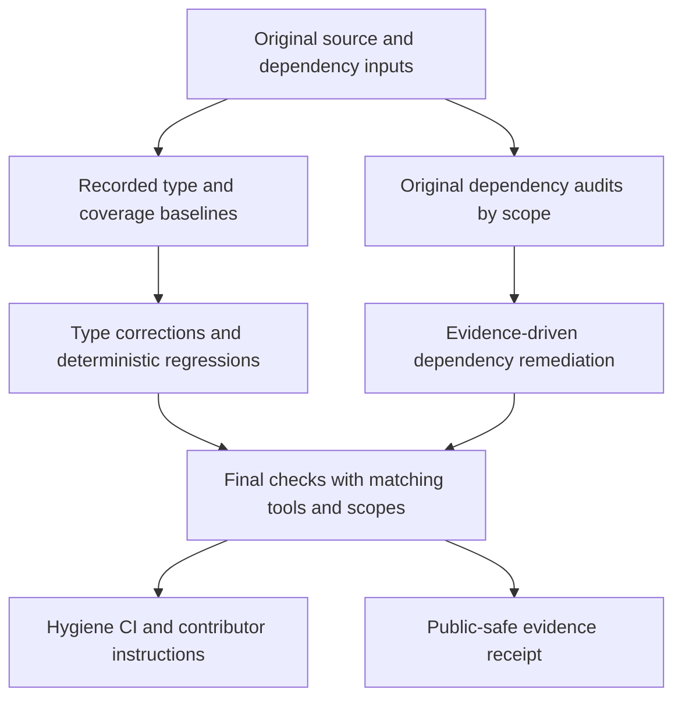

# Close fp-4 type, coverage, and dependency gaps - Plan

## Goal Capsule

- **Objective:** Downstream FOLIO applications retain reliable parsing, serialization, and optional search, while maintainers can reproduce the library's type, test-coverage, and dependency-health checks.
- **Means:** Establish fresh baselines, repair typed boundaries with focused regressions, audit resolved dependency scopes, and retain repeatable checks and evidence (KTD2–KTD6).
- **Authority:** The controller's `fp-4` mandate and standing rules; the chief repository's `docs/plans/2026-10-26-0705-feat-codex-drawdown-campaign-plan.md`, Goal Capsule and campaign R11, R15, R16, R17, R19, R20; this repository's `CLAUDE.md`.
- **Source limitation:** The chief repository and `ops/drawdown/mandates/_common.md` are absent from this sandbox. Their contents have not been read. Campaign citations below refer to the supplied standing rules, not reconstructed campaign text; the controller must supply the named excerpts before campaign acceptance.
- **Execution:** This stage commits only the plan. The later build stage invokes `lfg` on it, ending with local commits and verification evidence. The controller owns scanning, pushing, and opening the PR; the campaign merge gate owns merging (R7).
- **Stop conditions:** R8's exclusions remain hard stops. Unavailable inputs and failed checks remain explicit incomplete acceptance items under R9.

The mandate calls this item **hygiene**. The delivery metadata uses `planned` because this is named maintenance work, not an expansion.

---

## Product Contract

### Summary

Close the library's type-checking gaps and add deterministic coverage around parser, serialization, and optional-search boundaries. Audit core, published search-extra, and development dependencies separately, then make the verified maintenance checks reproducible.

### Problem Frame

The campaign catalog did not run tests. The latest repository receipt records passing tests alongside 47 inherited type diagnostics, but it does not establish today's state. Existing tests depend heavily on a live ontology, the type checker is undeclared, and coverage reports do not measure branches or enforce a floor. These gaps make regressions and environment mistakes harder for downstream maintainers to distinguish.

### Requirements

These R-IDs are local to this plan; **campaign R…** references identify the external requirements named by the controller.

**Types and behavior**

- R1. Reverify the supplied checkout and capture fresh type, coverage, and dependency baselines before changing implementation or dependency inputs.
- R2. Repair type-checking gaps without making optional search packages mandatory or weakening the supported Python floor and existing public contracts.
- R3. Add meaningful tests for the uncovered parser, model, and optional-search boundaries identified in this plan, with regressions before any corresponding behavioral fix.
- R4. Keep every existing test and assertion, including real MARISA, fallback, live-ontology, and benchmark coverage; no blanket type suppressions or coverage exclusions may manufacture success (campaign R15, R16).

**Dependencies and durable proof**

- R5. Audit the resolved core, published `[search]`, and development dependency scopes, retaining advisory evidence, scope limitations, and justified remediation separately.
- R6. Leave reproducible contributor checks and a public-safe receipt distinguishing measured results, inherited failures, unavailable checks, and unresolved findings.

**Delivery and boundaries**

- R7. Keep only `fp-4` on `drawdown/fp-4`, with local commits and controller-owned publication; do not configure a remote or seek GitHub credentials (campaign R15, R17, R19).
- R8. Exclude package-version bumps, publishing, publisher configuration, schema migrations, data rewrites, new outside services, spend, credential/security-setting changes, sends in the user's voice, unbacked deletion, and force-push. Never read prohibited secret or credential material (mandate and campaign R11).
- R9. Finish independent authorized work without waiting for Damien, but never count a blocked check as passed or an incomplete audit as clean (campaign R20).

### Key Decisions

- **Durable hygiene is the selected work.** Governs R1–R6. (session-settled: user-directed — chosen over speculative features: completed feature work leads to maintenance.)
- **No waiting for Damien through 2026-10-30.** Governs R9. (session-settled: user-directed — chosen over holding work for personal review: the campaign allocates zero user time during that period.)
- **Guarded campaign delivery remains settled.** Governs R7, R8. (session-settled: user-directed — chosen over holding expansions for personal review: the campaign merge gate owns acceptance.) This does not reclassify `fp-4` as an expansion.

### Scope Boundaries

Runtime fixes are limited to defects demonstrated by the planned regressions or required to honor existing typed contracts. No frontend changes are proposed, so no Playwright screenshot is applicable.

Considered and not built: a type-checker replacement, a general audit framework, exhaustive dependency-version combinatorics, a new scheduled security service, and a broad CI rewrite. Existing tools and focused jobs cover this item's needs; evidence that they cannot reproduce the checks would justify reconsidering the relevant choice.

#### Deferred to Follow-Up Work

`fp-1` owns branch reconciliation; `fp-2` owns long-running cache-pressure benchmarks; `fp-3` owns structured-query examples. Query ordering/limit semantics and configuration `use_cache` forwarding are adjacent findings, not part of this coverage tranche. PyPI publication and its trusted-publisher prerequisite remain separately held under the mandate.

---

## Planning Contract

### Reverified Starting State

Static inspection on 2026-10-26 found a clean `drawdown/fp-4` checkout at `94f1b29d2e7ea0dcd417b14f0d464bb8e53a0617`. Local `main` is `35814e6e405c3a17d7a2240d8ea0efe7b4179461`; no remote is configured. HEAD includes the `fp-1` plan, receipt, and ten regression cases in `tests/test_search_reconciliation.py`. Use the supplied HEAD as this lane's baseline; the older local `main` is not evidence of the controller's current target.

No tests, type checks, installs, dependency scans, or library runtime probes ran during this planning stage.

| Surface | Observed source evidence | Consequence for this plan |
| --- | --- | --- |
| Types | `CLAUDE.md` and `docs/plans/evidence/fp-1-branch-reconciliation.md` record 47 diagnostics, most recently with ty 0.0.92. `pyproject.toml` does not declare ty. | Reproduce with a recorded checker/environment; historical counts are not a fresh baseline. |
| XML typing | `types-lxml` is constrained below 2025 and locked to 2024.12.13; lxml is locked to 6.1.1. | Assess stub compatibility before rewriting code around diagnostics. |
| Coverage | `pyproject.toml` enables whole-package statement coverage and terminal/XML/HTML reports, without branch collection or a minimum. | Capture branch baselines and explicit test inventories. |
| Tests | `tests/test_folio.py` uses live ontology/cache inputs; `tests/test_iri.py` and `tests/test_search_reconciliation.py` provide deterministic patterns. | Add small RDF fixtures while retaining live integration coverage. |
| Dependencies | `uv.lock` records pydantic 2.12.5, httpx 0.28.1, RapidFuzz 3.14.3, MARISA 1.4.0, and ALEA 0.3.3. Default uv groups are `dev` and `search`. | Preserve original inputs; select audit roots explicitly. These versions are inventory, not vulnerability findings. |
| Automation | `.github/workflows/CI.yml` uses Poetry and floating Python `3.x`, without Ruff, ty, or audit steps. Its architecture labels do not select actual architectures. | Add focused hygiene checks without claiming cross-architecture coverage or replacing release CI. |

### Behavior Trace and Coverage Targets

Source inspection traces `FOLIO` construction through `load_owl`, `parse_owl`, model population, and search indexes. The existing regression fixture replaces the loader while exercising the real parser. Missing `rdf:about` nodes are skipped; missing parents remain relationship IRIs and generate a warning during edge construction. Text nodes can be `None`, despite string-only list/triple annotations.

`OWLClass.to_jsonld()` first adds untagged alternatives, then resets `skos:altLabel` inside each translation iteration. `search_by_definition()` checks RapidFuzz availability before unpacking the definition corpus, which can be empty. `format_classes_for_llm()` dereferences parent lookups although absent parents are tolerated during parsing. These are source-grounded defect candidates; U2/U3 must demonstrate their runtime consequences with tests.

LLM search already accepts list or `results`-object payloads, filters unknown/duplicate IRIs, sorts and limits results, and optionally returns three-field tuples. Its annotations describe only the two-field form. The plan tests this existing contract using async fakes, not a live model or model-quality evaluation.

### Assumptions

These are engineering defaults selected for unattended execution, not additional user-confirmed product requirements:

- Aim for zero ty errors in a fully specified development environment targeting Python 3.10, plus a separate core-only runtime check. A genuine third-party blocker remains an incomplete acceptance item.
- Limit the initial coverage tranche to model serialization, sparse RDF, optional search, and tests required by type fixes. Broader percentage chasing is not the goal.
- Use Python 3.10 and 3.14 for focused compatibility checks where available, because the manifest declares that floor and explicitly lists 3.14. This does not prove every permitted Python/platform combination.
- Add a minimal hygiene workflow and contributor instructions after the checks work locally. Existing full-suite CI and the publishing workflow remain in place.

### Key Technical Decisions

- KTD1. **Use Astra for this lane.** (session-settled: user-directed — chosen over the Sol-first ladder: the controller settled the model choice.) Applies to implementation and review of R1–R9.
- KTD2. **Preserve baseline inputs before tooling changes.** Save original manifest/lock identities and audit exports before adding ty or changing stubs. Compare original and final application code under the same chosen checker/stub environment; label any separate historical-tool comparison. This keeps tooling effects distinct from source fixes (R1, R2, R5).
- KTD3. **Correct types at their boundaries.** Retain ty, declare its reproducible development version, and select a tested lxml/stub combination. Prefer actual element instance types, optional-value narrowing, honest tuple shapes, and local typed boundaries over package-wide `Any` or ignores. Keep core-only installation separate from the checking environment (R2). Upstream [types-lxml history](https://github.com/abelcheung/types-lxml/releases) documents later lxml 6 and ty work; [ty environment guidance](https://docs.astral.sh/ty/type-checking/) explains environment discovery.
- KTD4. **Use explicit sparse-input behavior.** Preserve missing-identifier handling, valid content, and current whitespace conventions. Omit absent optional text from string-valued collections/triples rather than coercing it to `"None"`; leave absent scalar fields unset. Omit unresolved parent labels from LLM formatting while retaining relationship IRIs and known parents. With RapidFuzz available, an empty definition corpus returns an empty list; without it, retain the existing missing-extra error (R2, R3).
- KTD5. **Measure coverage in named scopes.** Record a before/after comparison of the unchanged existing offline selection, then separately report the final expanded offline suite. Preserve failing pre-fix regression evidence when a new test exposes a defect. Collect statement and branch counts for all `folio` modules with identical exclusions and fresh data; keep live-suite and core-only smoke results separate (R1, R3, R4). Derive the CI aggregate floor from the final passing offline run, rounded down to the nearest whole percent, and require the final expanded statement and branch rates to exceed the original offline baseline. The unchanged-suite comparison must not regress without a branch-denominator explanation tied to a necessary fix. [Coverage totals combine statements and branches](https://coverage.readthedocs.io/en/7.10.6/branch.html); [pytest-cov 7 subprocess coverage](https://pytest-cov.readthedocs.io/en/latest/subprocess-support.html) is not automatic, so isolated smoke results receive no coverage credit.
- KTD6. **Audit explicit resolved scopes without automatic fixes.** Use a recorded, isolated pip-audit version with hashed, locked uv exports and preserved markers. Select core with default groups disabled, the published `search` extra rather than its similarly named group, and the development group separately. Record interpreter/platform and unevaluated marker branches. Distinguish no known findings, findings, skipped/incomplete collection, and failed scans; no suppression list or `--fix` shortcut (R5, R9). [uv export](https://docs.astral.sh/uv/reference/cli/#uv-export) supports these scope controls; [pip-audit](https://github.com/pypa/pip-audit#usage) documents hashed inputs, strict collection, JSON reports, and its [limited security model](https://github.com/pypa/pip-audit#security-model). An audited lock does not establish safety of every version allowed by published dependency ranges.

### Check Separation

### Risks and Prerequisites

- **Campaign context:** The controller supplies the chief plan's Goal Capsule and cited R-ID excerpts. Their absence limits campaign acceptance; it is not a request for a personal login or decision.
- **Environment limits:** Unix-socket failures, unavailable downloads, live GitHub failures, or advisory-feed failures are recorded separately from library defects. Use the provided dependency caches; do not bypass sandbox restrictions.
- **Dependency compatibility:** Stub/tool updates can change diagnostic counts. Preserve KTD2's comparison and inspect every lock delta; runtime updates must be justified by audit evidence or compatibility with an in-scope fix.
- **Release boundary:** A finding requiring a major API redesign, package release, infrastructure change, or unavailable upstream fix stays unresolved in the receipt. R8 does not permit those changes in this lane.

---

## Implementation Units

### U1. Establish reproducible baselines

**Goal:** Make the before/after evidence attributable to this item.

**Requirements:** R1, R2, R5, R6, R9; KTD2, KTD3, KTD5, KTD6.

**Dependencies:** Build-stage authorization; the supplied checkout must be reverified.

**Files:** `pyproject.toml`, `uv.lock`, and new `docs/plans/evidence/fp-4-hygiene.md`. Existing test inventories: `tests/test_iri.py`, `tests/test_search_reconciliation.py`, `tests/test_folio.py`.

**Approach:**

1. Record source identity, clean/dirty state, Python/tool versions, selected dependencies, and original manifest/lock digests; preserve original audit exports before any dependency edit.
2. Capture current diagnostics and branch coverage for the existing deterministic selection, then attempt the unchanged full suite separately. Retain failure/skip counts and live-input limitations.
3. Declare ty as a development tool and evaluate a compatible lxml stub version, preserving a comparison of unchanged application code under the chosen final checking environment.
4. Keep original/final audit, offline, and live reports in distinct evidence locations with fresh coverage data. Commit concise sanitized summaries and machine-readable metrics; avoid generated HTML trees and machine-local paths.

**Patterns to follow:** The explicit identities and check limits in `docs/plans/evidence/fp-1-branch-reconciliation.md`.

**Test expectation:** No new runtime behavior in this unit. Validate lock consistency, environment selection, unchanged-suite results, and inclusion of every `folio` source module in coverage reporting.

**Verification:** A reviewer can reproduce each baseline and identify whether a difference came from source, tools, dependencies, tests, or network availability.

### U2. Repair typed parser and optional-search boundaries

**Goal:** Satisfy the existing contracts with accurate types and guarded optional values.

**Requirements:** R2–R4, R6, R9; KTD3, KTD4.

**Dependencies:** U1.

**Files:** `folio/graph.py`, `folio/models.py`; other `folio` modules only for freshly reproduced diagnostics. New `tests/test_parser_hygiene.py`, `tests/test_optional_search.py`, `tests/test_llm_search.py`, and `tests/test_core_install.py`.

**Approach:** Address optional import bindings, lxml element/text types, namespace-key types, variable-length tuples, lookup narrowing, and both LLM result tuple shapes. Reuse the tiny-document/real-parser pattern from `tests/test_search_reconciliation.py`. Keep optional-client construction and request helpers replaced by deterministic fakes during new tests. The core-install test runs a subprocess in a separately prepared core-only environment and must not inherit development/search packages.

**Execution note:** Add characterization or failing regression cases before changing the parser/formatter paths. Adopt KTD4 only at affected text and lookup boundaries; do not redesign query ordering, validation, or parser storage.

**Test scenarios:**

1. A valid class/property fixture with missing optional text retains populated fields and has no `None` entries in string collections/triples; missing `rdf:about` and unlabeled-node handling retain their established behavior.
2. A property with domain, range, and inverse links retains those IRIs and the expected lookup/index results after narrowing changes.
3. A class with known and unknown parents retains every relationship IRI while formatting only known parent labels; all-unknown parents do not crash formatting.
4. A core-only installed package imports and parses local RDF with all three optional distributions absent; prefix/exact/substring paths work, while optional fuzzy/LLM entry points retain their documented errors.
5. Async fake LLM responses in list and `results`-object form preserve filtering, deduplication, sorting, limits, and two-/three-field tuple shapes. Cover absent model and wrapped provider exceptions without a live request.
6. Parallel fake search preserves the same tuple shapes, global sorting/limit behavior, and exception wrapping across multiple search sets.

**Verification:** Zero ty errors under the recorded checking environment, passing new boundary tests, genuine core-only runtime evidence, and preserved existing test behavior. Any residual third-party blocker remains named and incomplete.

### U3. Close meaningful serialization and empty-search coverage gaps

**Goal:** Protect exported ontology data and empty search inputs with deterministic assertions.

**Requirements:** R3, R4, R6; KTD4, KTD5.

**Dependencies:** U1; coordinate shared graph edits with U2.

**Files:** New `tests/test_models.py`; `tests/test_optional_search.py`, `tests/test_parser_hygiene.py`, `folio/models.py`, `folio/graph.py`.

**Approach:** Confirm the JSON-LD overwrite and empty-definition candidates with regressions, then make the smallest fixes. Check semantic XML/JSON content rather than serialized whitespace. Use the missing-branch report to confirm that these cases close actual gaps; do not expand into cache-pressure or query-example work.

**Execution note:** The data-loss and empty-corpus cases should fail against the original implementation before their fixes.

**Test scenarios:**

1. JSON-LD for a class with untagged alternatives and two translations retains every alias and both language/value pairs.
2. Translation-only, alternative-only, and absent-label cases keep their respective data without inventing entries.
3. JSON round trips preserve populated optional/list fields; XML assertions verify namespaces, values, and omission of absent optional fields.
4. With RapidFuzz installed, both an empty graph and a graph whose classes have no definitions return an empty definition-search result; a populated definition still returns its expected class.
5. With RapidFuzz absent, empty and populated corpora retain the missing-extra error. Exact/substring structured filtering and Python prefix fallback remain usable.

**Verification:** The planned assertions pass, newly exercised branch destinations are listed, and the measured coverage changes meet KTD5 without exclusions or weakened old tests.

### U4. Audit dependencies and apply bounded remediation

**Goal:** Produce an attributable dependency-health assessment and resolve compatible in-scope findings.

**Requirements:** R1, R4–R6, R8, R9; KTD2, KTD6.

**Dependencies:** Original inputs from U1; final audit after U2/U3 tool and source changes settle.

**Files:** `pyproject.toml`, `uv.lock`, `docs/plans/evidence/fp-4-hygiene.md`, and sanitized audit artifacts under `docs/plans/evidence/fp-4/`. Any runtime remediation includes a focused regression in the applicable `tests` file from U2/U3.

**Approach:**

1. Audit the saved original scopes and final scopes with the same recorded auditor and advisory source; retain timestamps, input digests, package inventories, exit status, findings, and collection gaps.
2. Trace each finding to its dependency root and applicable affected range. Check published minimum requirements separately from the locked version.
3. Apply only evidence-supported compatible updates, then rerun affected tests and audits. Keep unrelated packages stable and retain no-fix or out-of-scope findings with their practical consequence.

**Test expectation:** Audit execution is evidence, not a unit test. Any dependency-driven behavior change needs a regression; dependency-only updates require lock/installation consistency and the existing runtime suite. Confirm exports exclude unintended default groups, include the published extra, and preserve marker distinctions.

**Verification:** Every selected scope has either a complete report with dispositions or an explicit incomplete result. Network errors, skipped packages, and unexamined environments cannot support a clean-audit claim.

### U5. Retain the checks in contributor workflow and CI

**Goal:** Make completed hygiene reproducible for the next contributor.

**Requirements:** R4, R6–R9; KTD1, KTD3, KTD5, KTD6.

**Dependencies:** U2–U4.

**Files:** New `.github/workflows/hygiene.yml`; `pyproject.toml` as needed for branch/report configuration; `CONTRIBUTING.md`, `CLAUDE.md`, `docs/plans/evidence/fp-4-hygiene.md`, and `tests/test_core_install.py`.

**Approach:** Add a focused uv-based job for Ruff, ty, deterministic coverage, and core-only compatibility on the selected Python versions. Configure the measured floor from KTD5 for that exact offline selection. Keep the full existing suite and release workflow intact. Document reproducible audit commands and scope limitations without adding an audit service or scheduled automation. Update the inherited 47-diagnostic note only to match measured final evidence.

**Test expectation:** No new product behavior. Validate workflow syntax and reproduce its commands locally; exercise the isolated core-install test and confirm optional dependencies are absent. Hosted execution is controller-owned after publication, so local validation is not a claim of green hosted CI.

**Verification:** Contributor instructions match the locked toolchain and CI selection. The receipt names every executed, failed, blocked, and controller-owned check and contains only public-safe, repo-relative paths.

---

## Verification Contract

These commands identify existing check interfaces, not a plan-stage execution script. The build receipt records exact environment and report-path options used.

| Check | Scope | Completion evidence |
| --- | --- | --- |
| Baseline identity and inputs | U1 | Original source/manifest/lock identities and exported scope digests precede mutations. |
| Type check: `uv run ty check folio/` | U1, U2, U5 | Recorded tool/stub environment targets Python 3.10; zero errors and no blanket suppression. |
| Ruff: `uv run ruff check folio/ tests/`; format check | U2, U3, U5 | Lint and formatting pass. Use the repository's prescribed fix/format commands before implementation commits. |
| Existing offline tests plus branch measurement | U1–U3 | Before/after inventory contains unchanged IRI/search-reconciliation tests; statement/branch/source counts are comparable. |
| Expanded offline regressions | U2, U3, U5 | All new scenarios pass; KTD5's coverage improvements and measured floor are documented. |
| Full suite: `uv run pytest tests/` | U1–U5 | All existing tests and benchmarks remain present and passing; unavailable live-network checks remain explicit acceptance gaps. |
| Core-only installation | U2, U5 | Supported-floor and selected-current Python runs verify real absence of optional modules and local-RDF behavior; no claimed subprocess coverage. |
| Locked exports and pip-audit | U1, U4 | KTD6's three scopes include input identities, evaluated packages, advisory outcomes, and limitations; reruns follow remediation. |
| Workflow and documentation | U5 | Syntax and locally reproducible commands agree; hosted results are obtained by the controller. |

Use isolated dependency/check environments and explicit frozen or locked operations where appropriate so measurement does not silently rewrite inputs. Preserve all comparison artifacts until the public-safe receipt is complete. Do not import or invoke a live LLM client to test its dependency metadata or response handling.

---

## Definition of Done

- U1 establishes fresh, reproducible evidence rather than inheriting the catalog's or `fp-1`'s test claims.
- U2 and U3 meet their type, behavioral, and coverage checks while preserving existing tests and the package's optional-dependency contract.
- U4 accounts for every audit scope and finding; unresolved findings or collection failures remain visible and prevent a clean-audit claim.
- U5 retains the verified checks and documents measured outcomes. No abandoned experimental implementation or unrelated change remains in the diff.
- The controller receives local commits, the plan, and the evidence receipt under R7. It supplies missing campaign excerpts and hosted verification before closing campaign acceptance.
- R8 remains satisfied. There is no new release, migration, outside service, frontend screenshot requirement, or personal decision for Damien in the planned work.
