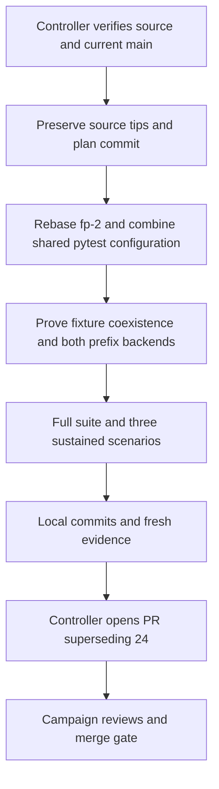

# Repair fp-2 benchmark integration for fp-5 - Plan

## Goal Capsule

- **Objective:** Maintainers can merge and reproduce the cache-pressure benchmarks from PR #24 alongside the library's current tests and tooling.
- **Means:** Preserve the original fp-2 work, rebase it onto verified current main, resolve its integration conflicts, and collect fresh acceptance evidence (R1–R5, KTD1–KTD4).
- **Authority:** The controller's fp-5 mandate and supplied standing rules; the chief repository's `docs/plans/2026-10-26-0705-feat-codex-drawdown-campaign-plan.md`, Goal Capsule and campaign R11, R15, R16, R17, R19, R20; this repository's `CLAUDE.md` and `CONTRIBUTING.md`.
- **Source limitation:** The chief plan and `ops/drawdown/mandates/_common.md` were not found in the available workspace and have not been read. Campaign R-ID citations here come from the supplied standing rules. Before build execution, the controller supplies the chief Goal Capsule and cited requirement excerpts so the executor can check this plan against that authority.
- **Execution:** This stage commits only this plan. The later build stage uses `lfg` and ends with local commits on `drawdown/fp-5`. One replacement PR supersedes #24; the controller scans, pushes, and opens it, and the campaign gate owns merging (R6).
- **Stop conditions:** R7's exclusions remain hard stops. Missing source or target provenance blocks history reconstruction; unavailable checks block acceptance, with ownership recorded under R8.

---

## Product Contract

### Summary

Integrate the existing fp-2 benchmark series with current main while retaining both branches' test contracts. Resolve the shared pytest configuration, repair backend-selection coverage affected by newer source, and provide fresh verification for the replacement PR.

### Problem Frame

The controller reports that PR #24 conflicts with main. Its benchmark work is absent from this checkout, which contains the later fp-1, fp-3, and fp-4 integrations. A conflict resolution that chooses either side wholesale would lose fixtures, benchmark controls, or coverage settings. Historical test results cannot establish that the combined tree works.

### Requirements

**Source preservation and integration**

- R1. Start the build branch from the verified `drawdown/fp-2` or `origin/drawdown/fp-2` source and rebase its complete work onto controller-verified current main, preserving this plan and recoverable original tips.
- R2. Keep every existing test and assertion from both source histories, and add focused regression coverage for the integration changes (campaign R15, R16).
- R3. Preserve fp-2's default short checks, explicit sustained-benchmark opt-in, three scenarios, workload thresholds, instrumentation rules, and bounded reporting.
- R4. Preserve the current main fixture, coverage, typing, dependencies, and library behavior, with the repository's full suite and required quality checks passing on the integrated revision.
- R5. Retain the original benchmark evidence with its original provenance and add public-safe fp-5 measurements tied to the implementation revision actually tested.

**Delivery and boundaries**

- R6. Keep this expansion on `drawdown/fp-5`, commit locally, and supply the controller with evidence for a new PR explicitly superseding #24; the lane must not configure a remote, seek credentials, push, or open the PR (campaign R15, R17, R19).
- R7. Exclude PyPI publishing, version bumps, schema migrations, data rewrites, new outside services, spend, credential/security changes, sends in the user's voice, unbacked deletion, and force-push. Never read prohibited secret or credential material (mandate and campaign R11).
- R8. Report missing inputs and failed or blocked checks accurately, complete independent authorized work, and route remaining dependencies to their execution owner (campaign R20).

### Key Decisions

- **Expansion delivery uses the campaign gate.** (session-settled: user-directed — chosen over holding expansions for discretionary review: the supplied guardrails govern acceptance.) Governs R2, R6, R8.
- **This lane remains limited to fp-5.** (session-settled: user-directed — chosen over speculative features after planned work: the mandate assigns one item, with durable hygiene after worthwhile expansions run out.) Governs R1, R7.

### Scope Boundaries

The scope is the fp-2 series, the conflicts needed to integrate it, and tests and evidence for that integration. No frontend change is planned, so no Playwright screenshot applies.

Production cache redesign, new benchmark scenarios, dependency upgrades, and CI redesign are not planned: the retained implementation and current tooling provide the requested behavior. A failing integration check attributable to this repair would justify the smallest necessary correction within R2–R4, not a new feature tranche.

#### Deferred to Follow-Up Work

Package publication and its trusted-publisher prerequisite remain the mandate's separate held work. This item neither performs nor schedules a release.

---

## Planning Contract

### Reverified Starting State

Static inspection on 2026-11-08 found `drawdown/fp-5` with no tracked changes and this plan already present as an untracked draft. The draft was reverified and updated in place. No tests, benchmark runs, rebase, or source edits ran during planning. The catalog and historical receipts are not a fresh passing test baseline.

| Surface | Observed evidence | Planning consequence |
| --- | --- | --- |
| Supplied branch tip | `1a59da2be0dd87da02a815a9e2ee44431c6bc696` contains the fp-1, fp-3, and fp-4 integrations. | Preserve this work; verify the controller's target rather than assuming a branch name proves freshness. |
| Local main | `35814e6e405c3a17d7a2240d8ea0efe7b4179461`, tagged v0.4.1. | This older ref is not the verified current target. |
| Source refs | Neither `drawdown/fp-2` nor `origin/drawdown/fp-2` exists; no remote is configured. | Controller-provided source identity is a build prerequisite. |
| Retained candidate | Unreferenced commit `4ce874c9fdfe5e59a997a43f096f5ff23461b7b1` contains the complete locally found fp-2 series. | Inspectable recovery material, not proof of PR #24's current head. |
| Common ancestor | The candidate and supplied branch share `06557c913164c5a15ca4075d0fc274c09768f64a`. | Compare only the candidate's four subsequent commits when accounting for preserved work. |
| Static conflicts | Read-only three-tree inspection of that ancestor, supplied tip, and candidate reports a `pyproject.toml` content conflict and a `tests/conftest.py` add/add conflict. | Resolve by preserving both contracts; actual replay must confirm conflicts against the verified target. The gate's original report was not available. |
| Historical evidence | `docs/plans/evidence/fp-2-cache-pressure.json` in the candidate identifies measured revision `58c53690a798c7b4378ea062f80d3d2e439b88df`. | Preserve that record and measure the repaired revision separately. |

The retained series, oldest first, is `59ffcb4` (plan), `fc55e13` (cache characterization), `58c5369` (opt-in sustained measurement), and `4ce874c9` (documentation and results). Relative to `06557c9`, it adds the fp-2 plan, benchmark documentation, evidence JSON, `tests/test_cache_pressure.py`, and `tests/conftest.py`, and changes pytest marker configuration in `pyproject.toml`. It does not change production code or the lockfile.

### Key Technical Decisions

- KTD1. **Verify provenance and preserve branch ancestry before replaying history.** Under R1 and R6, the controller supplies the source ref, current main, and any already-published fp-5 tip, confirming whether the retained candidate is the complete PR #24 work. Preserve the original source, supplied fp-5 tip, and committed plan in recoverable local references before reconstructing `drawdown/fp-5` from that source. Replay onto the verified target and retain this plan as an identifiable documentation commit. Any published fp-5 tip must remain an ancestor of the final branch; merge its saved plan history after the source rebase when needed, instead of merely replaying its content. Inspect the old/new commit-series comparison and account for every integration delta. A failed replay returns to the saved state without discarding work.
- KTD2. **Combine pytest configuration at the shared files.** Keep main's `local_graph` fixture, branch-coverage options, ty pin, Python 3.10 target, and lockfile. Add fp-2's `pytester` plugin registration, `--run-cache-pressure` option, marker-specific collection hook, and `cache_pressure` marker under the existing pytest table. Selecting one side wholesale cannot meet R2–R4.
- KTD3. **Make backend selection explicit in the retained test.** Adapt `test_prefix_backend_order_and_deduplication` to construct a separate graph while MARISA is disabled, following `tests/test_search_reconciliation.py::load_graph`. Assert that both tries are absent on the fallback graph and present for intended real-backend cases. Preserve the ordered/deduplicated expected results and cache-clearing discipline (R2, R4).
- KTD4. **Measure the rebased code and retain historical evidence.** Add `docs/plans/evidence/fp-5-cache-pressure.json` and `docs/plans/evidence/fp-5-rebase.md`; update `docs/benchmarks/cache-pressure.md` to identify the new measurements. Use the existing allowlisted report fields plus public tool/interpreter and revision identifiers. Raw benchmark output stays outside committed artifacts because it includes host metadata. Documentation-only commits may follow the clean implementation commit that was measured (R5).
- KTD5. **Keep model and review routing with the campaign.** (session-settled: user-directed — chosen over a Sol-first local ladder and bypassing cloud review: local work uses Astra, cloud builds use the default Sol model, and cloud PRs still require Astra and Fable reviews.) The controller records those reviews under R6; a local plan review does not satisfy them.

### Behavior Trace

At the candidate revision, the prefix parity test clears both result caches and disables the module-level MARISA dependency after constructing its graph. Current `folio/graph.py` chooses the case-sensitive trie path from the graph's existing `_label_trie` instance field, so that comparison still uses MARISA. The insensitive path checks both the module dependency and the instance trie and does reach the fallback. Both paths return cached results before backend selection when their result cache is warm. KTD3 repairs the setup to prove both backends; runtime proof belongs to U2.

The candidate's deterministic fixture exercises the real parser with 263 classes, 523 alternate labels, and 263 definitions. Source comparison found the prefix FIFO bounds and shared fuzzy LRU unchanged. The prefix caches each hold at most 128 entries; fuzzy label and definition searches share a 128-entry cache. These are static observations to verify after rebase.

The retained sustained runner requires each of `prefix-sensitive`, `prefix-insensitive`, and `fuzzy-mixed` to reach at least 60 measured seconds, 12,800 measured misses after warmup, and 10 checkpoints before the 180-second cooperative deadline. Deadline failure takes precedence even if the same batch crosses the success thresholds. Each scenario uses one benchmark invocation without plugin warmup; timing and memory are observations, not new performance or leak-freedom guarantees (R3).

### High-Level Technical Design

### Assumptions

These are engineering defaults for unattended execution, not new product requirements:

- The retained candidate is useful recovery material, but its correspondence to PR #24 remains unverified until the controller supplies source identity.
- The target should retain the supplied fp-1, fp-3, and fp-4 work. An unexpected omission requires provenance reconciliation before replay; the stale local main does not authorize dropping it.
- Current locked development/search dependencies and an isolated core-only installation remain sufficient. No dependency change is expected for combining pytest configuration.

### Prerequisites and Deferred Execution Questions

- **Before history reconstruction:** The controller supplies verified source and current-main refs, fp-5 publication status and any published tip, plus any additional gate conflict details. The lane never resolves this by adding a remote or finding credentials.
- **Before build execution:** The controller supplies the chief Goal Capsule and cited R-ID excerpts. Their absence is a context dependency, not a request for a login or a personal decision.
- **During build:** Determine whether the runner can complete subprocess/plugin checks, sustained measurements, and live ontology integration tests. Unix-socket or network restrictions remain failed or blocked evidence under R8; an offline subset cannot satisfy R4.
- **Before merge:** The controller rechecks the replacement against then-current main. If the target moves, refresh integration evidence and rerun checks affected by that movement before acceptance.

---

## Implementation Units

### U1. Preserve and rebase the original benchmark series

**Goal:** Recover the complete source history on the correct target without losing the plan or newer main work.

**Requirements:** R1, R2, R6–R8. **Dependencies:** Controller-verified source and target from KTD1.

**Files:** This fp-5 plan; `docs/plans/2026-10-26-1017-feat-fp2-cache-pressure-benchmarks-plan.md`; `docs/benchmarks/cache-pressure.md`; `docs/plans/evidence/fp-2-cache-pressure.json`; `pyproject.toml`; `tests/conftest.py`; `tests/test_cache_pressure.py`; new `docs/plans/evidence/fp-5-rebase.md`.

**Approach:** Apply KTD1 and KTD2. Record verified source, original ancestor, target, retained plan commit, any published fp-5 tip, and rebased series identities in the receipt. Account for already-integrated equivalent commits explicitly rather than silently omitting work. Keep all fp-2 artifacts, and inspect the resulting diff against the verified target for lost current-main content.

**Patterns to follow:** Existing fp-1 reconciliation receipt for provenance; current `tests/conftest.py` and `pyproject.toml` for the fixture and quality configuration; retained fp-2 hooks for opt-in behavior.

**Test expectation:** No new application behavior in this unit. Static ancestry, clean-index, commit-series, and preserved-file comparisons establish replay integrity; U2 tests the combined configuration.

**Verification:** Verified target and any published fp-5 tip are ancestors of the repaired branch. All original work is accounted for, the plan survives, conflicts are resolved, and no unexplained source, dependency, version, or existing-test loss appears in the diff.

### U2. Prove pytest coexistence and real backend coverage

**Goal:** Keep the combined ordinary suite and opt-in benchmark controls correct.

**Requirements:** R2–R4. **Dependencies:** U1.

**Files:** `tests/conftest.py`, `tests/test_cache_pressure.py`, `pyproject.toml`; existing verification targets `tests/test_search_reconciliation.py`, `tests/test_optional_search.py`, `tests/test_parser_hygiene.py`, and `tests/test_llm_search.py`.

**Approach:** Apply KTD3 and retain all existing fp-2 tests. Add a focused pytester regression that loads the complete merged conftest and uses `local_graph` alongside the pressure hooks. Existing marker tests copy that entire file into child runs, so exercising only the root fixture would miss import and plugin integration failures.

**Execution note:** Establish a regression that distinguishes the actual fallback backend before changing its setup; a result assertion alone can pass through the trie twice.

**Patterns to follow:** Existing pytester subprocess checks in `tests/test_cache_pressure.py`, the current backend assertions in `tests/test_search_reconciliation.py`, and main's local RDF fixtures.

**Test scenarios:**

1. A child pytest run imports the combined conftest, builds a small ontology through `local_graph`, and resolves the expected local class without a network loader.
2. Without opt-in, that child run executes its ordinary tests and ordinary benchmark while skipping only a marked pressure sentinel; enabling opt-in runs the sentinel without changing the other results.
3. Both case-sensitive and case-insensitive prefix parity cases execute real MARISA and an explicitly verified Python fallback, preserving expected ordering and deduplication after caches are cleared.
4. Retained short cases still prove capacity, FIFO/LRU eviction, hot hits, casefold reuse, positive results, deadline precedence, cleanup on failure, and rejection of invalid instrumentation modes.
5. Existing fixture consumers and search reconciliation tests pass with the merged plugin and hooks; missing real MARISA cannot silently count as real-backend coverage.

The added pytester seam verifies actual child-process configuration and fixture coexistence. It does not establish sustained cache behavior or live ontology compatibility; U3 covers those.

**Verification:** All short cache-pressure and coexistence checks pass, existing tests retain their assertions, and the default three sustained skips are identified separately from the explicit U3 run.

### U3. Verify the integrated revision and prepare supersession evidence

**Goal:** Supply reproducible evidence for the controller's replacement PR.

**Requirements:** R1–R8. **Dependencies:** U1, U2.

**Files:** `docs/benchmarks/cache-pressure.md`; new `docs/plans/evidence/fp-5-cache-pressure.json` and `docs/plans/evidence/fp-5-rebase.md`; verification across `tests/`, including `tests/test_cache_pressure.py` and `tests/test_core_install.py`.

**Approach:** Apply KTD4. Run the Verification Contract against a clean committed implementation revision, then add the sanitized measurements and receipt. Record failures, skipped cases, the measured revision, tool versions, and any subsequent documentation-only commit separately. The receipt identifies conflict resolutions and test additions, compares original versus replayed work, and gives the controller the tested base/head and intended #24 supersession.

**Test scenarios:**

1. All three sustained scenarios satisfy the existing runner contract in Behavior Trace, with coverage inactive and valid instrumentation; skipped, truncated, or failed scenarios remain incomplete evidence.
2. The complete ordinary suite passes with live ontology tests and existing benchmarks included, and the isolated core-only test executes using the configured core interpreter.
3. The final branch applies cleanly to the verified target and retains both test inventories; quality checks meet current main's zero-diagnostic type requirement.
4. New JSON and documentation agree on the measured revision, scenario identities, completion conditions, and selected-cache bounds, while the historical fp-2 JSON remains unchanged.

**Verification:** Local commits and evidence are ready for the controller. Full item acceptance also requires the controller-owned superseding PR and campaign checks under R6 and KTD5.

---

## Verification Contract

Use the frozen environments documented in `CONTRIBUTING.md`. Set `FOLIO_CORE_PYTHON` to the prepared isolated core-only interpreter for ordinary full-suite acceptance. The following are build-stage checks; none is claimed as passed by this plan.

| Check | Entry point or target | Required evidence |
| --- | --- | --- |
| History and preservation | Verified source series, current-main target, and any published fp-5 tip; U1 comparisons | Target and published-tip ancestry, no conflict markers or unmerged entries, preserved plan and test inventories, and an explanation for every replay delta. |
| Focused integration | `tests/test_cache_pressure.py` with the existing search and fixture consumers named in U2 | New coexistence regression and actual MARISA/fallback execution pass; sustained cases are explicitly distinguished. |
| Sustained benchmarks | Existing reproduction entry point in `docs/benchmarks/cache-pressure.md`, selecting `cache_pressure` with `--run-cache-pressure` and `--no-cov` | All three scenarios meet R3; only sanitized report fields enter the fresh evidence artifact. |
| Full suite | `uv run --frozen pytest tests/` | Complete ordinary suite passes, including existing benchmarks, live tests, and the configured isolated core check; enumerate every skip. |
| Current quality gates | Ruff lint and format checks from `CONTRIBUTING.md`; `uv run --frozen ty check folio/` | Both Ruff checks pass and ty reports zero diagnostics. The old fp-2 plan's historical nonzero type baseline does not govern this integration. |
| Existing hygiene coverage | Deterministic selection in `CONTRIBUTING.md` and `.github/workflows/hygiene.yml` | Combined statement/branch coverage meets the unchanged 58% floor with the isolated core check enabled. The existing hosted Python 3.10 and 3.14 matrix passes; distinguish hosted results from local results. |
| Frozen inputs | Current `pyproject.toml`, `uv.lock`, and repository package/version files | Only the intended pytest integration changes; no version, release, dependency, or publishing delta. |
| Public-safe evidence | New fp-5 receipt/JSON and updated benchmark document | Measured commit and environment identifiers agree; no host paths, raw host metadata, credential material, or invented results. |
| Controller acceptance | Replacement PR and campaign gate | New PR explicitly supersedes #24, old PR is excluded from merging, current-main compatibility and required hosted checks/reviews are recorded. |

An environment-blocked check remains incomplete acceptance. Preserve successful independent results and identify the runner capability the controller must supply; do not lower thresholds, remove assertions, or substitute deterministic-only evidence for the full suite.

---

## Definition of Done

- U1 accounts for the complete original work, retains this plan, and leaves the repaired branch based on verified current main.
- U2 proves the shared pytest configuration and both prefix backends without deleting or weakening an existing test.
- U3 passes the local Verification Contract and commits fresh, attributable evidence alongside the preserved historical record.
- The final diff contains only fp-5 integration work and its plan/evidence, with no abandoned experiment or unbacked deletion.
- The local handoff names `drawdown/fp-5`, this plan, expansion kind, tested base/head, evidence paths, and outstanding controller dependencies. No personal decision or held change is anticipated.
- The controller's replacement PR supersedes #24 and passes the campaign gate against current main. Local plan or build completion alone does not claim this final acceptance.
