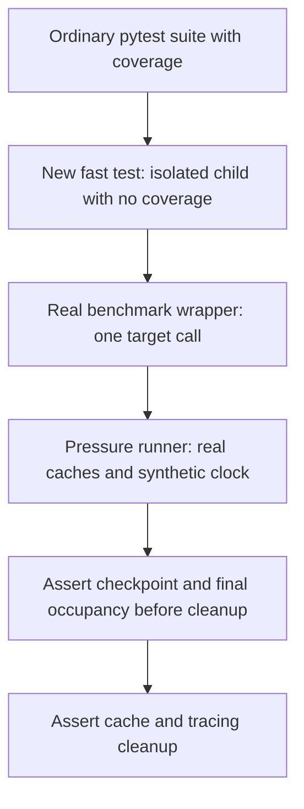

# Restore fp-6 cache-pressure benchmarks on current main - Plan

## Goal Capsule

- **Objective:** Maintainers can reproduce sustained search-cache checks on the current library, and ordinary test runs detect when the benchmark harness stops working.
- **Means:** Restore PR #24's implementation and add a fast integration test across its benchmark wrapper and pressure runner (KTD1–KTD4).
- **Scope:** Mandate item `fp-6`, kind `expansion`, on `drawdown/fp-6` only. This stage commits this plan; implementation belongs to the later build stage.
- **Authority:** The chief repository's `docs/plans/2026-10-26-0705-feat-codex-drawdown-campaign-plan.md`, its Goal Capsule and campaign R11/R15/R16/R17/R19/R20, the supplied mandate, and this repository's `CLAUDE.md` and `CONTRIBUTING.md`. Local R-IDs below are distinct from campaign R-IDs.
- **Delivery:** One implementation PR. The build stage uses `lfg` for implementation, simplification, review, verification and local commits. The controller scans, pushes and opens the replacement PR; campaign reviews and the merge gate govern merging (R7).
- **Stop conditions:** Missing source commit, unresolved conflicts, or failing required verification prevent implementation completion. Honor the supplied hard stops under R6; an owner-only blocker uses campaign R20's decision format.

**Authority limitation:** The chief repository and named campaign plan are absent from the accessible sandbox. Their Goal Capsule and cited requirement text have not been read. The controller must supply or cross-check those excerpts before build authorization. This plan uses the supplied standing rules without reconstructing missing text. This is a controller prerequisite, not a request for a personal login or decision.

---

## Product Contract

### Summary

Carry PR #24's cache-pressure harness, tests and documentation onto the supplied current-library baseline. Add a normal-suite test that runs the actual benchmark plugin and pressure runner together with a tiny workload while retaining the real cache limits.

### Problem Frame

The current checkout lacks the cache-pressure work from PR #24. Its historical branch diverged before shared fixtures, coverage settings, KAOS search and release 0.4.2 landed. Copying its old configuration wholesale would discard current behavior. Its existing fast tests exercise the pressure runner and benchmark wrapper separately, leaving their combined execution without a fast regression check.

### Requirements

**Restoration and regression proof**

- R1. Replay the PR commits through `a9768debb9a815773b83163031418728e1666142`, retaining their harness source, tests, opt-in controls, documentation and evidence while preserving current-library changes. The completed item must carry substantive source/test additions against the confirmed main baseline.
- R2. Add a distinct new `test_` function that runs the benchmark harness with a tiny configuration and asserts the v0.4.1 cache bounds; it must execute in the ordinary test selection without sustained-run opt-in.
- R3. Preserve all existing tests and assertions from both the current checkout and PR #24, and pass the repository's full suite. Do not delete or weaken tests to resolve conflicts or accommodate environmental failures.
- R4. Preserve the long scenarios' opt-in behavior and thresholds: at least 60 measured seconds, 12,800 post-warmup misses and 10 checkpoints per scenario, before the 180-second cooperative deadline. Keep ordinary coverage and benchmark selection intact.

**Compatibility and delivery**

- R5. Preserve package version, dependency declarations and lockfile, production search behavior, current fixtures, type configuration and coverage options. No PyPI publication, version bump, schema migration, data rewrite, outside service or frontend change is authorized.
- R6. Keep work local to this item and branch under campaign R11/R15/R16/R17/R19. Do not add a remote, find credentials, spend, change credentials/security settings, send messages in the owner's voice, delete without verified backup or force-push. Never read the prohibited secret locations or file patterns named in the supplied standing rules.
- R7. Hand the controller a verified implementation branch for one new PR explicitly described as superseding **#24 and #27**. Preserve the required campaign reviews and merge gate; no lane publication or package release is part of completion.
- R8. Keep historical fp-2 measurements attributable to their recorded revision and distinguish them from new smoke, full-suite and sustained-run results. Commit only public-safe evidence with repo-relative paths and accurate execution limits.

### Key Decisions

- **Expansion delivery through existing guardrails** (session-settled: user-directed — chosen over holding expansions for owner review: the campaign authorizes guarded expansion delivery). Governs R3, R6, R7.
- **Campaign execution model and review route** (session-settled: user-directed — chosen over the Sol-first local ladder: local work uses Astra, cloud builds use the cloud default, and cloud PRs retain Astra and Fable reviews). Governs R7; this plan does not reopen model selection.
- **Bounded mandate work** (session-settled: user-directed — chosen over speculative features after mandate exhaustion: subsequent work becomes durable hygiene). Governs R5, R6; no other item is authorized here.

### Scope Boundaries

Restore and reconcile the existing test harness; do not redesign production caches, search ranking, public APIs or benchmark infrastructure. KAOS benchmarking and broad dependency/coverage work belong outside this item. R5 owns the release and infrastructure exclusions.

Considered and not built: a new benchmark framework, scheduled measurement service, or machine-specific timing/memory gate. Existing pytest tooling and the PR's finite measurements cover the requested outcome; a demonstrated separate need would justify reconsideration.

---

## Planning Contract

### Verified Starting State

Static inspection only; no pytest or benchmark execution occurred during planning.

| Evidence | Observed state | Consequence |
| --- | --- | --- |
| Branch and worktree | Clean `drawdown/fp-6`, starting HEAD `627fa4c450392c30282baaf68fd9c9cfeda0f955` | Keep the plan and later implementation on this branch. |
| Local `main` | `35814e6e405c3a17d7a2240d8ea0efe7b4179461`, an ancestor of supplied HEAD | The local ref is stale; it is not proof of current upstream main. |
| Remote | No git remote configured | Controller supplies fresh-main verification; do not repair authentication or remotes. |
| PR head | `a9768debb9a815773b83163031418728e1666142` exists as a commit | The missing-object stop condition does not currently apply. |
| PR merge base with supplied HEAD | `60da2d66b82e8232cfcf55a6908522475e870131` | Four PR commits remain to replay. |
| Current library | Package 0.4.2; shared `local_graph` fixture, branch coverage, ty configuration, KAOS and expansion features present | Preserve these changes when resolving conflicts. |
| PR-only paths | Harness, cache-pressure docs, fp-2 plan and JSON absent from supplied HEAD | A plan-only or receipt-only final build would not fulfill R1. |

The replay sequence is `2efab9e` (plan), `3ea4ba0` (offline harness/contracts), `8834d20` (opt-in measurements), then `a9768de` (documentation/evidence). Use the mandate's merge-base-to-PR-head cherry-pick range in the build stage, not file copying or a reset to the stale `main` ref.

### Key Technical Decisions

- KTD1. **Integrate onto the supplied newer baseline.** Record `627fa4c450392c30282baaf68fd9c9cfeda0f955` as this lane's observed integration base and preserve its descendants. Review the item delta against that base, then require the controller's comparison with fresh main before publication. Never infer an item-only diff from the stale local `main` (R1, R5, R7).
- KTD2. **Merge shared configuration additively.** Retain `tests/conftest.py::local_graph` while adding the PR's pytester registration and pressure-only option/hooks. Add only the cache-pressure marker to current pytest configuration, preserving `--cov-branch`, ty and dependency sections (R3–R5).
- KTD3. **Select RapidFuzz only inside the restored cache fixture.** Keep `FOLIO_SEARCH_BACKEND=rapidfuzz` active for the entire `graph_factory` fixture using the existing `SEARCH_BACKEND_ENV` constant. Current public fuzzy searches choose their backend per call; KAOS bypasses `_basic_search`, whose shared 128-entry LRU is the measurement target. Follow `tests/test_kaos_search.py`'s explicit-backend pattern without a suite-wide override (R1, R5).
- KTD4. **Join the real plugin and runner in an isolated fast test.** Add `test_benchmark_harness_tiny_cache_bounds` in `tests/test_cache_pressure.py`. Its pytester child imports the actual fixture/helpers and executes `benchmark_once` into `measure_pressure` for all three scenarios with inactive coverage, real search calls and `TickClock`. This closes the seam between the existing return-42 plugin probe and direct runner tests (R2).
- KTD5. **Retain historical measurements separately.** Restore the fp-2 JSON with its recorded revision `58c53690a798c7b4378ea062f80d3d2e439b88df` unchanged. Record new build results in `docs/plans/evidence/fp-6-cache-pressure.md` and, for completed long runs, `docs/plans/evidence/fp-6-cache-pressure.json`. Do not relabel inherited or logical-clock results as current sustained measurements (R8).

### Behavior and Integration Boundaries

`folio/graph.py` still defines a 128-entry limit. Prefix caches belong to each graph and evict in insertion order; insensitive keys are case-folded. `_basic_search` is a process-wide LRU shared by public RapidFuzz label and definition calls. The restored fixture and runner clear that cache before and after their work.

`measure_pressure` warms the selected cache, records occupancy before cleanup, checks every batch and retains bounded checkpoints. `benchmark_once` rejects coverage/profiling and incompatible instrumentation, invokes one pedantic target, and checks invocation count. Preserve its ownership checks and failure cleanup. The child process in KTD4 allows the ordinary parent suite to keep coverage enabled.

### Assumptions and Prerequisites

- **Controller prerequisite:** Supply or cross-check the campaign excerpts identified in the Goal Capsule before build authorization. If they contradict this plan, resolve the conflict before implementation.
- **Base assumption:** The supplied branch represents the intended current-library baseline. The controller must confirm fresh main; any intervening main changes require integration and repeated affected checks before merge. No ref movement is authorized in this plan stage.
- **Tiny-workload default:** Keep the actual 128-entry capacity and complete synthetic ontology. Use the PR's small-budget helper with more than 128 measured misses after warmup and a generous logical deadline. This is an engineering choice for regression strength, not a new real-time performance target.
- **Execution unknowns:** Actual test outcomes, elapsed smoke time, sustained-run completion and dependency availability require build-stage execution. Network or Unix-socket failures remain named verification gaps, never passing evidence.

---

## Implementation Units

### U1. Restore the PR while retaining current configuration and backends

**Goal:** Make the original cache-pressure implementation available on the current library.

**Requirements:** R1, R3–R6; KTD1–KTD3.

**Dependencies:** Controller prerequisites above and a freshly verified starting state.

**Files:** Restore `tests/test_cache_pressure.py`, `docs/benchmarks/cache-pressure.md`, `docs/plans/2026-10-26-1017-feat-fp2-cache-pressure-benchmarks-plan.md` and `docs/plans/evidence/fp-2-cache-pressure.json`; merge `tests/conftest.py` and `pyproject.toml`. Preserve `folio/`, `uv.lock` and existing test files.

**Approach:**

1. Record the baseline and existing test results before replaying all four PR commits. Finish the cherry-pick sequence with every intended source/test change retained.
2. Resolve the expected add/add fixture conflict and pytest-options overlap using KTD2. Audit against both sides rather than choosing an entire file from either side.
3. Apply KTD3 to the restored fixture. Strengthen the PR's fallback comparison by clearing the instance label trie as well as disabling the module backend; current sensitive-prefix dispatch otherwise still uses the existing trie.

**Patterns to follow:** `tests/test_kaos_search.py` for scoped backend selection, `tests/conftest.py` for shared local RDF fixtures, and the PR's own factory/cache cleanup.

**Test scenarios:**

1. Restored capacity, FIFO/LRU, case-fold reuse and positive-result assertions pass under the intended backend with actual 128-entry caches.
2. Both sensitive and insensitive prefix comparisons exercise the real trie and actual Python fallback, retaining all expected IRIs and ordering assertions.
3. Existing `local_graph` consumers and KAOS tests retain their original fixture/backend behavior; the new fixture restores its environment on teardown.
4. Ordinary collection skips only marked long-pressure cases; explicit opt-in selects them without changing ordinary benchmarks or coverage defaults.

**Verification:** Restored fast contracts and existing affected tests pass; the branch contains the six PR paths and no unresolved cherry-pick/conflict state. These tests catch configuration and backend reconciliation errors, not long-duration performance.

### U2. Add the fast benchmark-to-runner integration regression

**Goal:** Make ordinary tests detect a broken cache-pressure harness.

**Requirements:** R2–R5; KTD3, KTD4.

**Dependencies:** U1.

**Files:** `tests/test_cache_pressure.py`.

**Approach:** Reuse the existing pytester subprocess/import pattern to run one child suite covering `prefix-sensitive`, `prefix-insensitive` and `fuzzy-mixed`. Use the real `graph_factory`, wrapper, runner and request function. Shorten only the test's time/work budget; retain R4's long-run defaults and strict instrumentation checks.

**Execution note:** The new test must be a distinct addition beyond the imported PR tests and must run without the `cache_pressure` marker or an availability-based skip. A fake benchmark or mocked search would miss this integration boundary.

**Test scenarios:**

1. Each scenario completes through the installed plugin and real runner with more than 128 measured misses, positive known-result requests and some cache hits.
2. The report declares capacity 128, the selected final cache contains exactly 128 entries, and every reported final/checkpoint cache size is at most 128. Check reported occupancy before teardown rather than treating an empty cleared cache as proof.
3. Request counts equal hits plus misses and result-bearing counts; the existing per-request exact-result assertions remain active.
4. The wrapper invokes its target exactly once and produces benchmark statistics. After the runner returns, owned tracing is stopped and the shared fuzzy cache is empty.
5. The parent suite retains normal coverage while the child satisfies the wrapper's inactive-coverage requirements. Existing invalid-instrumentation, deadline, insufficient-pressure and failure-cleanup tests remain unchanged.

**Verification:** The new ordinary-suite test passes for all three scenarios without long waits or real-time timing assertions. It proves harness compatibility and cache limits, not sustained-performance claims.

### U3. Verify current behavior and retain reproducible evidence

**Goal:** Give the controller inspectable acceptance evidence for the replacement PR.

**Requirements:** R1–R8; KTD1, KTD5.

**Dependencies:** U1, U2.

**Files:** `docs/benchmarks/cache-pressure.md`, `docs/plans/evidence/fp-6-cache-pressure.md`, and `docs/plans/evidence/fp-6-cache-pressure.json` when new long measurements complete. Test interfaces remain `tests/test_cache_pressure.py` and the full `tests/` suite.

**Approach:** Update reproduction documentation for the scoped RapidFuzz choice, new fast integration check and historical/new evidence distinction. Obtain separate full-suite and opt-in sustained results from the completed implementation. Retain revision, effective workload, tool versions, selected scenarios, outcomes and limitations in public-safe evidence, following the PR's report allowlist.

**Test expectation:** U1/U2 own behavioral tests. This unit verifies those tests, the full suite, all three real-clock long scenarios and documented invocations. Historical JSON and simulated-clock smoke success cannot satisfy current long-run acceptance.

**Verification:** The Verification Contract passes, evidence identifies the tested implementation, and the controller receives the substantive diff and replacement-PR statement in R7. Any uncompleted check remains explicit and prevents claiming the item complete.

---

## Verification Contract

The following are build-stage check interfaces, not plan-stage executions. Use the locked environment described in `CLAUDE.md` and `CONTRIBUTING.md` without dependency or version changes.

| Check | Interface | Required evidence |
| --- | --- | --- |
| Baseline and replay | Recorded refs, PR range and resulting diff | All four PR commits' intent retained; item delta compared with the supplied base and controller-confirmed main. |
| Fast harness contracts | `uv run --frozen pytest tests/test_cache_pressure.py` | Existing fast tests and the new U2 function pass; only the three long cases require opt-in. |
| Full suite | `uv run --frozen pytest tests/` | Passing full selection with baseline/final results and explicit skip/failure accounting. `-k 'not benchmark'` is insufficient and excludes U2 by name. |
| Sustained pressure | `uv run --frozen pytest tests/test_cache_pressure.py -m cache_pressure --run-cache-pressure --no-cov` | Three completed real-clock scenarios meet R4 with enabled benchmarks and no profiling. |
| Lint | `uv run --frozen ruff check folio/ tests/` | No lint errors; use repository-prescribed fixes only for implementation edits. |
| Formatting | `uv run --frozen ruff format --check folio/ tests/` | Formatting passes without unrelated churn. |
| Types | `uv run --frozen ty check folio/` | Zero diagnostics with the existing Python 3.10 target and locked stubs. |
| Evidence and scope | Diff and report inspection | R5, R6 and R8 satisfied; historical measurements remain unchanged and current evidence is attributable. |

An environmental failure, collection error, missing benchmark statistics, skipped new smoke test or partial scenario run is not a pass. Preserve existing tests and report the exact incomplete check to the controller. Raw plugin output may contain host metadata; commit only the sanitized harness fields and public revision/tool identifiers.

---

## Definition of Done

- U1 restores the PR's source and tests while preserving current-library behavior and configuration.
- U2 adds and passes the new normal-suite integration regression; importing an existing test or committing only a plan/receipt does not satisfy R1/R2.
- U3 passes the full suite and required static checks, records current sustained verification and keeps evidence provenance accurate.
- No abandoned experimental changes, unrelated edits, prohibited release work or weakened tests remain in the item diff.
- The controller verifies applicability to fresh main, completes campaign reviews and publishes one PR explicitly superseding #24 and #27 under R7. Local completion does not claim publication or merge.
- No frontend is changed, so no Playwright screenshot is required. No owner-only decision or held infrastructure change is presently identified.
