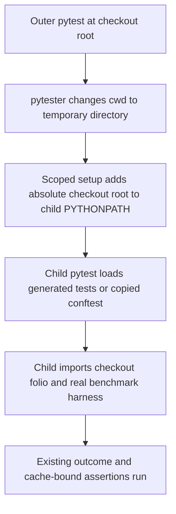

# Restore fp-7 cache-pressure tests in Linux CI - Plan

## Goal Capsule

- **Objective:** Maintainers can run the cache-pressure checks locally and in Linux CI, with ordinary tests detecting regressions in the benchmark harness and cache bounds.
- **Means:** Restore PR #31 and repair its nested pytest imports using KTD1–KTD3.
- **Scope:** Mandate item `fp-7`, kind `expansion`, on `drawdown/fp-7` only. This stage commits the plan; implementation belongs to the later build stage.
- **Authority:** The chief repository's `docs/plans/2026-10-26-0705-feat-codex-drawdown-campaign-plan.md`, its Goal Capsule and campaign R11/R15/R16/R17/R19/R20, the supplied mandate and standing rules, and this repository's `CLAUDE.md` and `CONTRIBUTING.md`. Local R-IDs below are distinct from campaign R-IDs.
- **Delivery:** One replacement PR. The build stage runs `lfg` on this plan for implementation, simplification, review, verification and local commits. The controller scans, pushes and opens the PR; the campaign merge gate owns merging under R7.
- **Stop conditions:** Missing source commit, unresolved conflicts, or failing required verification prevent implementation completion. R6 governs hard stops; an owner-only blocker follows campaign R20's decision format.

**Authority limitation:** The chief repository, named campaign plan and `ops/drawdown/mandates/_common.md` are not exposed in this sandbox. Their Goal Capsule and cited requirement text have not been read. Campaign references here come from the supplied standing rules, without reconstructing missing text. The controller must supply or cross-check those excerpts before campaign acceptance; this is a controller context dependency, not a personal login or taste decision.

---

## Product Contract

### Summary

Restore the cache-pressure harness, tests and documentation from PR #31 onto the supplied lane baseline. Repair package discovery in its pytester subprocesses and prove the repair in both the repository environment and the actual Linux CI installation layout.

### Problem Frame

The checkout lacks PR #31's benchmark work. The controller reports that its tiny-harness test fails during collection with `ModuleNotFoundError: No module named 'folio'` in every Linux CI job. A development environment that installs the project can hide that failure.

The workflow builds a wheel, then installs dependencies without the root project and runs the outer suite with a relative source path. Nested pytest processes run from temporary directories. Three test families depend on importing the checkout across that boundary, including one that imports the package while loading its copied `conftest.py`.

### Requirements

**Restoration and behavior**

- R1. Cherry-pick PR #31's commits through `68f84b65198e38a4ec298c2f026c8153cf66e33f`, preserving its substantive harness, tests, configuration, documentation and evidence together with the current library's changes.
- R2. Repair the inner package-import failure for every affected pytester caller without changing the outer CI installation or test contract.
- R3. Add a focused regression test for the repaired subprocess import boundary and retain the ordinary-suite tiny harness test across all three cache scenarios.
- R4. Preserve every existing test and assertion from both the lane and incoming PR, including intended instrumentation rejections and existing opt-in behavior. Do not delete, skip or weaken a test to obtain a passing result (campaign R15, R16).
- R5. Pass the harness tests and the full suite in the repository environment and the CI job's install layout, with fresh evidence that distinguishes local reproduction from hosted CI acceptance.

**Boundaries and delivery**

- R6. Preserve package version, dependencies, lockfile, production APIs and cache behavior. Exclude PyPI/publisher work, version bumps, schema migrations, data rewrites, new outside services and frontend changes. Follow campaign R11 and the supplied hard stops: no spend, credential/security changes, messages in the owner's voice, unbacked deletion, force-push or prohibited secret-file reads.
- R7. Keep this item on `drawdown/fp-7` with local commits only; never add a remote or seek credentials. Hand the controller a verified implementation for one new PR explicitly described as superseding **#31 and #24** (campaign R15, R17, R19).
- R8. Preserve historical measurement provenance and produce public-safe fp-7 evidence using repo-relative paths. Report missing inputs and blocked checks accurately under campaign R20; a plan-only or receipt-only branch cannot satisfy the build stage.

### Key Decisions

- **Guarded expansion delivery** (session-settled: user-directed — chosen over holding expansions for personal review: the campaign assigns acceptance to its guardrails and merge gate). Governs R4, R7, R8.
- **Campaign model and review route** (session-settled: user-directed — chosen over the Sol-first local ladder: local work uses Astra, cloud builds use the cloud default, and cloud PRs retain Astra and Fable reviews). Governs R7; this plan does not reopen that choice.
- **Bounded campaign scope** (session-settled: user-directed — chosen over speculative features after mandate exhaustion: subsequent work becomes durable hygiene). Governs R6, R7; no other mandate item is authorized here.

### Scope Boundaries

The repair belongs in the restored test harness. Production cache redesign, search-ranking changes, dependency upgrades, workflow modernization and target-architecture configuration are outside this item.

Considered and not built: installing the root project in CI to hide the import gap, replacing subprocess runs with in-process pytest, or adding a new benchmark service. The existing subprocess boundary is needed for coverage isolation, and explicit child import setup addresses the observed failure. Reconsider broader changes only if build-stage evidence shows this boundary cannot satisfy R2–R5.

---

## Planning Contract

### Verified Starting State

Repository/history/source inspection and static checks were performed. No pytest or benchmark run occurred during planning; old receipts do not establish this branch's test baseline.

| Evidence | Observed state | Planning consequence |
| --- | --- | --- |
| Branch and worktree | `drawdown/fp-7`, initially clean, no remote | Keep the supplied branch and local-only delivery |
| Lane starting commit | `627fa4c450392c30282baaf68fd9c9cfeda0f955`, tagged `v0.4.2` | Preserve this newer library baseline |
| Local `main` | `35814e6e405c3a17d7a2240d8ea0efe7b4179461`, tagged `v0.4.1`, ancestor of the lane | Do not rewind to the stale local ref or present its broad diff as fp-7 work |
| Required PR object | `68f84b65198e38a4ec298c2f026c8153cf66e33f` exists; its merge base with the lane is `627fa4c450392c30282baaf68fd9c9cfeda0f955` | The required restoration input is available |
| Incoming range | Eight commits; nine changed files; no `folio/` production changes | Restore the complete range, including harness source and tests |
| CI job | `.github/workflows/CI.yml`: Poetry build, no-root install, relative `PYTHONPATH=.` outer test invocation | Wheel installation is not the reported job's test layout |
| Static checks | Ruff lint, Ruff format check and ty pass on the starting checkout | No baseline static-check repair is needed |

The incoming commits, in order, are `13df3cd`, `61711d1`, `41d5f4b`, `cab90e6`, `170a6ff`, `13c9771`, `f1b4681`, and `68f84b6`. Recompute the range from the build-stage HEAD's merge base with the required PR head before replaying it, so an intervening controller update is respected.

### Key Technical Decisions

- KTD1. **Preserve the lane baseline and replay the complete PR range.** Implements R1 and R7. Use the supplied cherry-pick approach, resolving conflicts by retaining current-library changes plus the PR's intent. Compare the result against the recorded lane baseline as well as local `main`; the controller must confirm applicability to its current main before publication.
- KTD2. **Give the child process an absolute checkout import path.** Implements R2 and R3. Derive the source root from the real test module's resolved location and prepend it to child `PYTHONPATH` with the platform path separator, preserving inherited entries. Use a narrowly scoped shared helper or fixture for all three caller families and restore environment changes afterward. Apply setup before child collection, including copied-conftest imports.
- KTD3. **Retain subprocess isolation and real benchmark execution.** Implements R2–R4. A parent-only `pytester.syspathinsert` does not repair these subprocess calls: pytester's child environment is derived from its current directory and inherited `PYTHONPATH`, not the parent's modified `sys.path`. In-process pytest would also compromise coverage isolation. This choice follows the [official pytester source](https://docs.pytest.org/en/stable/_modules/_pytest/pytester.html), specifically `chdir`, `syspathinsert`, `popen` and `runpytest_subprocess`; confirm it against the resolved pytest version during build verification.
- KTD4. **Reproduce the exact no-root job in a fresh environment.** Implements R5. A Poetry environment that has never installed `folio-python` is the decisive reproduction. Build the distribution without installing it, then use the workflow's no-root install and relative-path test invocation. Keep the development venv and any supplementary installed-wheel check separate so editable installation cannot mask the defect.
- KTD5. **Record new evidence without rewriting historical measurements.** Implements R8. Add `docs/plans/evidence/fp-7-cache-pressure-ci.md` for the tested revision, environment provenance, commands, exit codes and limitations. The restored fp-2/fp-6 results remain attributable to their original revisions.

### High-Level Technical Design

The environment setup in KTD2 reaches both collection entry points. It does not change production imports or disable the instrumentation checks owned by the harness.

### Assumptions and Dependencies

- The supplied lane HEAD represents the controller's intended current-library starting point. This is an execution assumption, not proof of remote-main freshness; KTD1 requires the controller's final comparison.
- Dependency resolution, current Poetry compatibility, public ontology access and complete test outcomes remain execution-time facts. `.github/workflows/CI.yml` uses Python `3.x` and the repository has `uv.lock` but no Poetry lockfile; record resolved versions rather than claiming equivalence from the tool name alone.
- The six Linux matrix entries share the same runner and command body. Their target labels currently change artifact names rather than selecting architectures. Local reproduction covers that common installation/import path; hosted results for all jobs remain a controller/gate requirement.
- The chief campaign excerpts remain the context dependency stated in the Goal Capsule. No missing source object or owner-only decision was found.

---

## Implementation Units

### U1. Restore PR #31 on the supplied library baseline

**Goal:** Carry the benchmark implementation into this item while retaining the current library.

**Requirements:** R1, R4, R6–R8; KTD1, KTD5.

**Dependencies:** Required PR object and the build-stage starting-state check.

**Files:** Restore `tests/test_cache_pressure.py`, the additions to `tests/conftest.py` and `pyproject.toml`, `docs/benchmarks/cache-pressure.md`, `docs/plans/2026-10-26-1017-feat-fp2-cache-pressure-benchmarks-plan.md`, `docs/plans/2026-11-11-0037-fix-fp6-cache-pressure-restoration-plan.md`, and the historical `docs/plans/evidence/fp-2-cache-pressure.json`, `docs/plans/evidence/fp-6-cache-pressure.json`, and `docs/plans/evidence/fp-6-cache-pressure.md`.

**Approach:** Replay the verified commit range under KTD1. Retain the current shared ontology fixture, coverage options, type configuration, package metadata and lockfile. The incoming configuration delta registers pytester and the pressure marker/opt-in hooks; it does not require a release or production cache change.

**Execution note:** Establish the unchanged-library baseline, then reproduce the incoming PR's collection failure in KTD4's clean environment before repairing it.

**Patterns to follow:** Incoming `graph_factory`, `benchmark_once`, `measure_pressure` and `test_benchmark_harness_tiny_cache_bounds`; existing `tests/conftest.py` and `folio/graph.py` cache contracts. The harness seam checks real cache behavior and plugin execution, but does not by itself prove CI import isolation.

**Test scenarios:**

1. Preserve prefix FIFO, fuzzy LRU, casefold reuse, real MARISA and Python-fallback checks from the incoming PR.
2. Preserve the tiny harness's three scenarios, real benchmark statistics, single measured invocation, more than 128 misses, positive hits/results and 128-entry cache bounds at final and checkpoint snapshots.
3. Preserve cleanup, invalid-instrumentation, pressure-budget and bounded-report tests, along with existing current-library tests.

**Verification:** The diff from the lane baseline contains substantive harness/test/configuration changes and historical documentation. Any unresolved conflicts or unexpected source/version/dependency changes block completion.

### U2. Repair and test child-process package discovery

**Goal:** Make every affected pytester child import the checkout package before collecting its tests.

**Requirements:** R2–R4, R6; KTD2, KTD3.

**Dependencies:** U1.

**Files:** `tests/test_cache_pressure.py`.

**Approach:** Apply the shared import setup to `test_benchmark_harness_tiny_cache_bounds`, `test_installed_plugin_invocation_and_instrumentation`, and `test_only_pressure_marker_is_gated`. Add a distinct `test_` regression exercising the child import boundary with relative and absent inherited `PYTHONPATH`. Keep helpers local to this module and retain each caller's subprocess invocation and outcome assertions.

**Execution note:** Demonstrate the failing no-root case before the fix and rerun it afterward; a passing editable-environment test alone is insufficient.

**Patterns to follow:** Existing monkeypatch-managed fixtures and subprocess tests. `tests/test_core_install.py` demonstrates testing from a temporary directory, but its isolated installed-wheel probe proves a different contract and stays unchanged. This unit's child import checks catch cwd-dependent lookup failures; U3 supplies the no-root environment that excludes an editable-install false positive.

**Test scenarios:**

1. With inherited `PYTHONPATH=.` and then with it absent, a child launched from pytester's temporary directory imports `folio` from the intended checkout. Exercise this through the new regression and verify package origin.
2. An existing useful inherited path remains available to the child, and scoped environment setup does not leak after the test.
3. The tiny-harness child reports exactly three passes and retains all cache-occupancy, accounting, checkpoint and cleanup assertions.
4. The copied real conftest imports successfully: without opt-in only the marked long test skips, and with opt-in both generated tests pass. The ordinary benchmark runs in both cases.
5. Valid instrumentation passes; disabled benchmarks, cProfile, disabled GC and active coverage still produce the expected inner failure and matching diagnostic. Collection errors must not substitute for those deliberate failures.

**Verification:** All three caller families and the new regression pass in both required layouts without a new skip, weakened assertion, global import mutation or CI workflow workaround.

### U3. Prove acceptance in both layouts and record the handoff

**Goal:** Give the controller reproducible evidence for the repair and replacement PR.

**Requirements:** R5–R8; KTD4, KTD5.

**Dependencies:** U1 and U2.

**Files:** `docs/plans/evidence/fp-7-cache-pressure-ci.md`; update `docs/benchmarks/cache-pressure.md` only where the import/reproduction guidance needs clarification. Verification targets are `tests/test_cache_pressure.py` and the full `tests/` directory; workflow and installation-test source remain unchanged.

**Approach:** Record the before/after no-root result, focused development-environment result and full-suite outcomes. Capture interpreter, Poetry, pytest, benchmark and coverage versions, plus evidence that the Poetry environment has no installed root project. Follow the repository's independent core-only setup so its existing installation test receives the documented interpreter. Preserve old evidence under KTD5.

**Test scenarios:**

1. The workflow's build/no-root-install/test sequence succeeds in a fresh environment using its relative outer source path, including the repaired harness cases.
2. The repository venv passes the focused cache-pressure tests and full suite with its normal coverage settings.
3. The full CI-layout suite passes too; expected inner failures and existing opt-in skips are recorded separately from outer failures, collection errors and blocked live-ontology checks.

**Verification:** Fresh evidence supports R5 and names the tested commit. The controller receives the substantive branch diff and the statement that the new PR supersedes #31 and #24. Hosted matrix success and current-main integration are verified by the controller before merge.

---

## Verification Contract

These checks belong to the build stage. Planning has only established the source/history facts and passing static baseline above.

| Check | Repository command or entry point | Required evidence |
| --- | --- | --- |
| Focused development tests | `uv run --frozen pytest tests/test_cache_pressure.py` | All fast cases pass, including the new regression and three pytester caller families |
| Development full suite | `uv run --frozen pytest tests/`, with `FOLIO_CORE_PYTHON` prepared per `CONTRIBUTING.md` | Full result, with live-ontology access and existing skips accounted for |
| CI distribution build | `poetry build` in the fresh CI environment | Successful build; no publication or wheel installation |
| CI dependency installation | `poetry install --no-root` in that same environment | Successful installation with no installed `folio-python` root project |
| CI focused reproduction | `PYTHONPATH=. poetry run pytest tests/test_cache_pressure.py` | Before-fix collection failure and after-fix success in the same no-root layout |
| CI full suite | `PYTHONPATH=. poetry run pytest tests/` | Successful outer suite using the workflow's command; no editable-install shortcut |
| Lint | `uv run --frozen ruff check folio/ tests/` | No diagnostics |
| Formatting | `uv run --frozen ruff format --check folio/ tests/` | No formatting changes required |
| Types | `uv run --frozen ty check folio/` | Zero diagnostics |
| Diff and delivery review | Recorded lane baseline, local `main`, required PR head, and controller's current main | Harness/test changes present; R4/R6 boundaries preserved; required campaign reviews retained |

Preserve the restored sustained-run opt-in and its budgets. Historical long measurements are not fresh fp-7 proof; a new sustained run is required if the repair changes measurement behavior, budgets or instrumentation rather than only package-path setup. Tiny runs must never be represented as sustained measurements.

The acceptance receipt records exact commands actually used and their exit codes. Environment or network failures remain unresolved checks, not successful acceptance. Do not reduce the suite, relax assertions, install the root project into the no-root environment, or change the workflow to make the reproduction pass.

---

## Definition of Done

- U1 restores the complete available PR intent and retains the newer library baseline.
- U2 fixes all affected subprocess entry points and adds regression coverage while preserving R4.
- U3 supplies fresh focused and full-suite evidence for both layouts under R5; blocked checks cannot be marked complete.
- The branch contains substantive harness and test changes against the confirmed main baseline, with no abandoned experiment code or unrelated modifications.
- R6 remains satisfied, and the fp-7 receipt distinguishes old measurements, local reproduction and hosted checks.
- The controller receives local commits for a new PR that supersedes **#31 and #24**, confirms current-main applicability and required CI/reviews, then uses the campaign merge gate under R7.

The plan-stage deliverable is only this committed plan. Completion of that stage does not claim implementation, full-suite success or a published PR.
