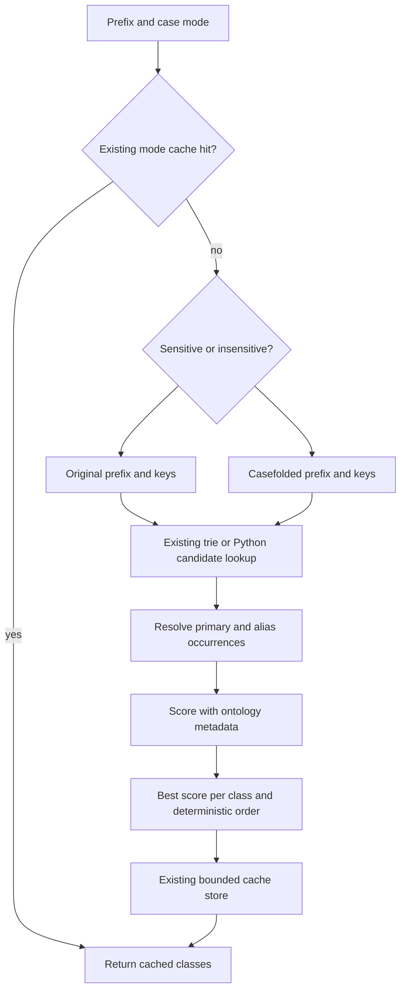
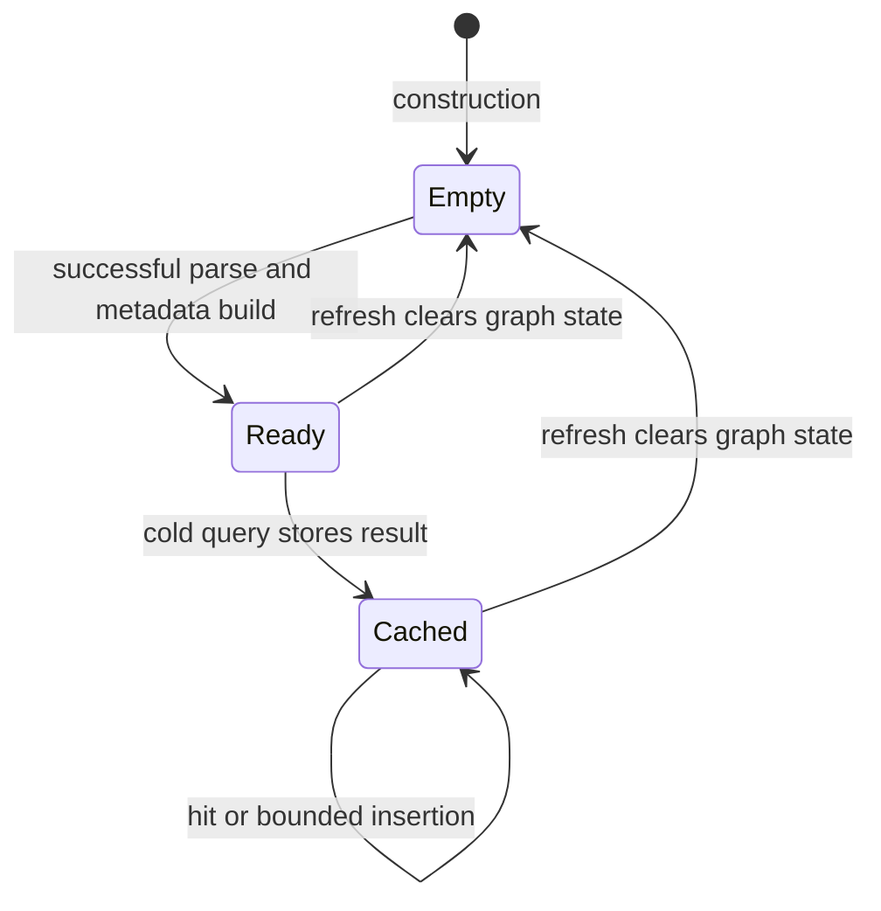

# Rank fp-8 prefix search by relevance - Plan

## Goal Capsule

- **Objective:** Downstream FOLIO applications show useful concepts earlier in prefix-search results, including California ahead of Caldas and Tax Law first for their specified queries.
- **Means:** Shared relevance scoring with ontology-derived metadata and deterministic regression coverage (KTD1–KTD4, A1).
- **Authority:** The controller's `fp-8` mandate and standing rules, this repository's `CLAUDE.md` and `CONTRIBUTING.md`, and [issue #17](https://github.com/alea-institute/folio-python/issues/17). Campaign authority is the chief repository's `docs/plans/2026-10-26-0705-feat-codex-drawdown-campaign-plan.md`, Goal Capsule and campaign R11, R15, R16, R17, R19, R20.
- **Source limitation:** The chief repository, its campaign plan, and `ops/drawdown/mandates/_common.md` are unavailable in this clone. Their contents have not been independently read; campaign R-ID references below come from the supplied standing rules. The supplied mandate fully specifies this item's behavior. The controller should make the named excerpts available to the build lane.
- **Execution:** This stage commits only this plan. A later build stage invokes `lfg` on it and delivers one item on one branch under R7. The controller publishes the PR; the campaign gate merges it. The implementation PR closes #17.
- **Stop conditions:** Do not cross R8's exclusions or declare completion without R6's verification. Record unavailable inputs or failed checks accurately under R9.

---

## Product Contract

### Summary

Replace prefix-search tuple ordering with documented relevance scoring in both case modes. Preserve the existing matching behavior, optional-backend support, and bounded caches while adding tests for the requested ranking and its compatibility constraints.

### Problem Frame

Current prefix search ranks matching keys by primary-label status and length before resolving them to classes. That cannot consider the class's ontology position. The published ontology also exposes a limitation in the proposed signals: California and Caldas share the same branch and depth, so length alone still favors Caldas. A1 records the narrow additional evidence proposed to meet the required example.

### Requirements

R-IDs are local to this plan; **campaign R…** refers to the external campaign.

**Ranking and compatibility**

- R1. Replace the `(is_alt_label, len)` ordering in both prefix-search paths with a documented score weighing primary label, exact match, shorter matching label, shallower ontology depth, and a named module constant containing the low-utility branch penalty list.
- R2. `search_by_prefix("Cal")` ranks California above Caldas, and `search_by_prefix("Tax")` ranks Tax Law first; both examples have additive tests in both case modes.
- R3. Keep the public signature and return type unchanged, and preserve matching membership, Unicode casefold behavior, primary-label precedence, and deduplication. Every existing prefix-search test must pass unchanged, including Michigan-first and primary-prefix-before-exact-alias assertions.
- R4. Preserve v0.4.1's separate 128-entry prefix result caches, oldest-entry eviction, cached misses, casefold cache keys, and clearing on successful refresh. Ranking metadata must track the current ontology and remain bounded by its size.

**Proof and delivery**

- R5. Add a ranking bullet under `CHANGES.md`'s existing `Unreleased` heading and update the search docstring to explain the signals and ordering.
- R6. Add deterministic tests for new behavior and pass the full suite, existing lint/format/type gates, and isolated core-only checks; never delete, skip, or weaken existing tests (campaign R15, R16).
- R7. Keep `fp-8` on `drawdown/fp-8` with local commits only. Do not configure a remote or seek credentials; the controller scans, pushes, opens the PR, and hands it to the merge gate (campaign R15, R17, R19).
- R8. Exclude PyPI publishing, version bumps, migrations, data rewrites, new outside services, spend, credential/security changes, sends in the user's voice, unbacked deletion, and force-push. Never read prohibited secret or credential files (mandate and campaign R11).
- R9. Finish independent work and report genuine unavailable prerequisites with their effect rather than inventing acceptance evidence (campaign R20).

### Key Decisions

- **Campaign delivery owns publication and merging.** Governs R6–R8. (session-settled: user-directed — chosen over holding expansions for personal review: guardrails and the campaign merge gate own acceptance.) This item is `planned`, not an additional expansion.
- **Only the assigned item proceeds.** Governs R7, R8. (session-settled: user-directed — chosen over speculative features when mandates run out: durable hygiene is the campaign's fallback, not permission to expand this item.)

### Scope Boundaries

The change is class prefix ranking and its documentation/tests. Fuzzy search, kaos, query expansion, public models, parsed property/triple contents, dependency changes, and other mandate items are outside this work.

Do not add a public score API, configurable ranking profiles, query logging, or a popularity service. The requested outcomes can be met with the existing ontology; observed demand for those capabilities would justify separate work. Do not fix the existing difference where tries omit labels shorter than three characters and the fallback admits them. R3 preserves each backend's current candidate set.

No frontend is changed, so Playwright screenshots do not apply. No held change is anticipated under R8.

#### Deferred to Follow-Up Work

`CONTRIBUTING.md` requests corresponding documentation in the separate `openlegalstandard.org` repository. Provide the controller a concise ranking description for that follow-up; this lane does not modify another repository or publish a package.

---

## Planning Contract

### Reverified Starting State

Read-only inspection on 2026-11-13 found a clean `drawdown/fp-8` at `627fa4c450392c30282baaf68fd9c9cfeda0f955` (merge #30). Local `main` remains at its ancestor `35814e6e405c3a17d7a2240d8ea0efe7b4179461`, thirteen commits behind the supplied tip. There is no remote. Preserve the supplied branch; do not reset to the older local `main`. Measure this item's changes from the supplied tip, while the controller resolves the publication base.

`pyproject.toml` already declares 0.4.2. Both prefix helpers in `folio/graph.py` still use tuple ordering; no class-depth or branch scoring exists there. `_store_prefix_cache` retains the 128-entry oldest-entry policy. `parse_owl` resets both prefix caches, and successful `refresh()` reparses the ontology. No tests, application builds, or library runtime probes were run during planning.

The source trace follows `parse_owl_class` → label/alias indexes → optional tries → case-specific candidate lookup → class-index deduplication → result cache. Preferred and hidden labels enter the alias index. The existing `get_parents` traversal is recursive and depth-limited, so its list length is not a reliable minimum-depth measure.

### Ontology Evidence and Assumptions

Static XML inspection used the same default source named in `folio/config.py`: [FOLIO 2.0.0](https://raw.githubusercontent.com/alea-institute/FOLIO/2.0.0/FOLIO.owl), SHA-256 `b6ed82e6d17b7cb1d468453e4111ec08ca091d72a6849be2b58dd37692cb6ef9`. These are input facts, not measured search results.

- California (`RCAE61b75805b43D0c65E1bb`) and Caldas (`R47266bC6C284D8565e69144`) both have depth four from `owl:Thing`, Location ancestry, zero children, and their own primary/preferred label. Neither has a matching exact `Cal` alias.
- Eight distinct class sources have a direct `rdfs:locatedIn` restriction targeting California; none target Caldas. Five target Michigan. The observed sources are courts, but the proposed count measures ontology references, not proven popularity.
- Tax Law (`RDGdgxwCGXpkY1zfT2WwGl9`) has depth three under Area of Law. Tax and Revenue Law is shallower, so depth cannot dominate the shorter-label signal if R2 is to hold.
- The current parser surfaces `seeAlso` restrictions but does not expose `locatedIn` restrictions in class attributes or triples. The narrow scan in A1 must therefore read the already-loaded XML tree privately.

These are engineering assumptions, not additional user requirements:

- A1. **Use bounded location-reference prominence as a sixth signal.** The five required signals alone cannot satisfy the inspected California/Caldas example with a positive shorter-label preference. Count distinct valid source classes that directly reference a Location target through `rdfs:subClassOf/owl:Restriction`, with direct `owl:onProperty` equal to `rdfs:locatedIn` and direct `owl:someValuesFrom` identifying that target. Retain only one count per target. Ignore duplicate source-target pairs, self references, non-Location targets, unresolved/external targets, invalid source classes, malformed restrictions, and nested anonymous restrictions. This is a read-only ranking input, with no change to public parsing outputs.
- A2. **Use all recognized branch ancestry.** A class receives the penalty only when its nonempty set of recognized FOLIO branches contains exclusively penalized branches. A mixed ordinary/penalized membership, or no recognized branch, is neutral. Include each branch root in its own membership.
- A3. **Use minimum known depth.** Measure shortest parent-edge distance from virtual `owl:Thing`; a class with no declared parents is also a root for custom fixtures. Missing-only ancestry or a rootless cycle has unknown depth and gets no depth bonus. A valid root path remains usable alongside missing parents or cycles.
- A4. **Use the initial weights below, then validate the whole contract.** Adjustment during implementation is allowed if recorded with test evidence and it preserves R1–R4 and the dominance bounds. No label-name, country, or example-IRI special case is acceptable as a substitute for the generic ranking policy.

### Key Technical Decisions

- KTD1. **Rank classes by their best matching key and its actual provenance.** Both backend-specific key collectors feed one shared scorer and ordering step. Resolve primary and alias occurrences separately even when the same text belongs to both indexes. Keep the maximum score per class index, then order by descending score and canonical IRI for ties, with class index only as a final tie for duplicate IRIs. This avoids alias duplication and fixes the old key-level ambiguity without changing candidate membership (R1, R3).
- KTD2. **Keep every score component bounded.** Apply the six terms in the table below, using the selected case mode for exactness and matching-key length. The primary bonus dominates exactness plus all secondary variation; exactness dominates secondary variation within a provenance tier. This preserves the pinned compatibility test (R1–R3, A1, A4).
- KTD3. **Build private metadata once per parsed ontology.** After the parser has retained classes and built parent relations, derive a private adjacency view, cycle-safe breadth-first depths, complete branch memberships, and A1 counts. Keep only per-class scoring inputs after construction. Do not walk the ontology or rescan XML inside a query or its sort key. Preserve virtual `owl:Thing` edges even though `class_edges` omits them (R4, A1–A3).
- KTD4. **Reuse existing caches and refresh lifecycle.** Initialize/rebuild metadata at the parsing boundary and discard it when refresh clears graph state. Cache hits return before any scoring work; cold queries still store through `_store_prefix_cache`. No new query-result cache, global graph cache, or changes to `_basic_search` are needed (R4).
- KTD5. **Keep backend and installation proof distinct.** Use `tests/conftest.py`'s `local_graph` and the explicit backend setup in `tests/test_search_reconciliation.py`. Require real MARISA for its cases, force fallback on fresh graphs, and verify the installed core wheel separately. This catches different integration failures without changing old tests (R6).
- KTD6. **Preserve campaign model routing.** (session-settled: user-directed — chosen over the Sol-first ladder: local work uses Astra; cloud build stages use the default cloud model, and cloud PRs still receive the campaign's Astra and Fable reviews.) Local configuration has `cross_model_review_mode: off`; local review cannot be represented as the later campaign review gate.

The initial score is the sum of these terms. This table is design guidance, not production code. `L` is the length of the matching key after the mode's normalization; `d` is A3's depth; `n` is A1's distinct-source count.

| Signal | Contribution | Bound or purpose |
| --- | --- | --- |
| Primary occurrence | 1,000 when the key is this class's primary label | Alias occurrence gets zero |
| Exact occurrence | 100 when normalized key equals normalized prefix | Otherwise zero |
| Shorter matching key | 20 / (1 + L) | At most 20 |
| Shallower known depth | 5 / (1 + d) | At most 5; unknown gets zero |
| Low-utility branch | −2 when A2 applies | Otherwise zero |
| Location references | 5 × n / (1 + n) | Nonnegative and less than 5 |

Secondary terms span at most 32 points. Thus 100 preserves exactness within a provenance tier, and 1,000 preserves primary precedence even against an exact alias. Using the inspected inputs, California's proposed score for `Cal` is approximately 1005.263 and Caldas's is 1001.857. Tax Law scores 1003.750 and Tax and Revenue Law 1002.667. These are formula illustrations; actual ranking acceptance still requires tests against all candidates.

Keep the penalty list in `PREFIX_LOW_UTILITY_BRANCHES`, an immutable module constant of `FOLIOTypes` values: `LANGUAGE`, `LOCATION`, `STANDARDS_COMPATIBILITY`, `SYSTEM_IDENTIFIERS`, `MATTER_NARRATIVE`, `CURRENCY`, `DATA_FORMAT`. This is the policy in [issue #17](https://github.com/alea-institute/folio-python/issues/17); all other recognized branches remain neutral. In particular, `MATTER_NARRATIVE_FORMAT` is distinct from `MATTER_NARRATIVE`.

A hard-coded California boost would need fewer lines but would encode an unexplained geographic preference. Counting every RDF reference would introduce a broader signal than required. A1 uses a single existing relation that distinguishes the acceptance examples and needs no outside service. These choices do not warrant a separate experimental implementation or a new public interface.

### High-Level Technical Design

The query flow keeps backend discovery separate from ranking:

The metadata lifecycle is independent of query volume:

The score table above describes the non-obvious ordering policy and the case/backend matrix below makes the supported combinations explicit.

| Case mode | Backend | Query key | Candidate rule | Ranking input |
| --- | --- | --- | --- | --- |
| Sensitive | MARISA | Original prefix | Existing original-case trie | Original matching key |
| Sensitive | Python | Original prefix | Existing `startswith` fallback | Original matching key |
| Insensitive | MARISA | Casefolded prefix | Existing lowercase trie and original-key map | Casefolded matching key |
| Insensitive | Python | Casefolded prefix | Existing casefold `startswith` fallback | Casefolded matching key |

Retained metadata scales with class count, and temporary adjacency/deduplication with ontology edges and references. Branch traversal may use one visited pass per fixed branch root. Cycles must terminate, and cached searches must not rebuild metadata. This work does not redesign failed-refresh recovery or add support for arbitrary direct mutation of public class lists.

---

## Implementation Units

All units belong to one implementation PR. U1 precedes U2; U3 verifies their combined behavior.

### U1. Derive bounded ontology ranking inputs

**Goal:** Make depth, branch penalty, and A1 prominence available without per-query graph traversal.

**Requirements:** R1, R3, R4, R6; KTD2–KTD4 and A1–A3.

**Dependencies:** None.

**Files:** Modify `folio/graph.py`; create `tests/test_prefix_ranking.py` using `tests/conftest.py`'s existing fixture. Private-helper tests cover graph derivation; they do not establish public ranking by themselves.

**Approach:** Add the named branch constant and private per-instance metadata. Derive the inputs after parsing and clear them with the existing refresh path. Use only classes retained by the parser, and do not alter public class/property/triple contents.

**Patterns to follow:** `FOLIO.parse_owl`, `FOLIO.refresh`, the canonical `FOLIO_TYPE_IRIS` mapping, and `local_graph`.

**Execution note:** Add small offline fixtures before changing the parser lifecycle. The five-signal conflict must remain visible in the fixture's actual parent graph.

**Test scenarios:**

1. A rooted chain gets minimum hop depths; multiple parents choose the shortest valid path without losing other branch memberships.
2. A root-connected cycle terminates; a rootless cycle and a missing-only parent get unknown depth; a valid path alongside a missing parent still resolves.
3. Each declared penalty branch, its root, an ordinary branch, a mixed membership, and an unclassified class follow A2. Matter Narrative Format remains ordinary.
4. Valid direct `locatedIn` references from two distinct retained source classes contribute two; duplicate source-target restrictions contribute once. A synthetic location with no real-world place name gets the same treatment.
5. Wrong predicates, malformed or nested restrictions, non-Location targets, missing targets, invalid owners, and self references do not contribute. Test no-reference and large-count saturation.
6. Refresh with unchanged labels but different parents, branch membership, and references replaces all ranking inputs. Class/property counts and representative public contents remain unchanged by the private derivation.

**Verification:** Offline metadata cases pass without network or LLM setup; retained metadata is limited to current classes and no global unbounded cache is introduced.

### U2. Apply shared relevance ordering to both prefix paths

**Goal:** Satisfy the ranking examples while preserving the public prefix contract.

**Requirements:** R1–R4, R6; KTD1–KTD5 and A4.

**Dependencies:** U1.

**Files:** Modify `folio/graph.py`; extend new `tests/test_prefix_ranking.py`; append new tests to `tests/test_folio.py`. Leave existing test functions and assertions unchanged. Offline tests isolate ranking; the existing published-ontology fixture proves integration with real data.

**Approach:** Retain each path's candidate collection and cache lookup, and route collected occurrences through the common scorer. Add deterministic replicas of the recorded ontology facts, including the otherwise-identical California/Caldas factors and direct reference distinction. Add published-ontology assertions using the recorded concept IRIs as well as labels.

**Test scenarios:**

1. For `Cal`, both named concepts are present and California precedes Caldas. For `Tax`, Tax Law is first. Run both case modes and insensitive lower/mixed-case variants, on fresh and warm caches.
2. Preserve all existing Michigan and primary-prefix-before-shorter-exact-alias tests unchanged. Add extreme secondary inputs to prove KTD2's primary/exact dominance bounds.
3. Within equal provenance, an exact match beats an extension; equal structural terms prefer the shorter key; equal lexical terms prefer a shallower concept; otherwise-equal classes expose the branch penalty.
4. A class matching several aliases and its primary label appears once with its best occurrence score. A key primary for one class but an alias for another does not grant primary credit to both.
5. Unicode casefold equivalents and casefold-colliding original keys match the existing rules. Equal-score classes order identically under MARISA and fallback regardless of candidate enumeration order.
6. Empty and absent prefixes preserve existing membership and cache behavior. Ordered backend parity fixtures use labels eligible in both backends; separately characterize the pre-existing short-label difference without repairing it.
7. More than 128 distinct hit/miss queries leave both maps at the current bound with oldest-entry eviction. Casefold variants share the insensitive key; hits do not recompute scores or metadata; fuzzy-cache configuration is unchanged.
8. Warm both caches, refresh an ontology whose labels stay fixed but rank inputs change, and assert new ordering. Previously cached misses also become hits under the existing refresh contract.

**Verification:** All new public ranking scenarios pass in the four case/backend combinations where applicable, and every old prefix test remains intact and passes.

### U3. Document and verify the complete ranking change

**Goal:** Deliver a tested behavior change with a clear explanation for downstream callers.

**Requirements:** R5–R9; KTD5, KTD6.

**Dependencies:** U1, U2.

**Files:** Modify `CHANGES.md` and the `search_by_prefix` docstring in `folio/graph.py`; append an additive installed-wheel case in `tests/test_core_install.py`; create `docs/plans/evidence/fp-8-prefix-ranking.md` for concise build results.

**Approach:** Describe all signals, including the inferred reference proxy and deterministic ties. Use the existing installed-core subprocess pattern to prove ordering without search extras. Record baseline/final verification against the supplied tip, any failures, and the controller's downstream documentation handoff.

**Patterns to follow:** `CONTRIBUTING.md`, `.github/workflows/hygiene.yml`, and `tests/test_core_install.py`'s isolated interpreter probe.

**Test scenarios:**

1. The non-editable core-only wheel, outside the checkout with isolated imports, returns expected offline primary/exact/ranked results with optional search packages absent. Keep the old core test unchanged.
2. The focused, deterministic, and full-suite gates below pass with all existing tests preserved. New tests make no live LLM calls.

**Verification:** The evidence receipt names actual commands, environments, outcomes, and limits. It contains no credentials or machine-local paths. R5 documentation is accurate, and the implementation PR is described as closing #17.

---

## Verification Contract

Build-stage checks must begin from a fresh baseline on the supplied branch. Planning has not established a passing runtime baseline. Use frozen dependency resolution and the setup/install layouts in `CONTRIBUTING.md` and `.github/workflows/hygiene.yml`; no version or dependency changes belong to this item.

| Check | Repository command or source | Acceptance |
| --- | --- | --- |
| Focused regressions | `uv run --frozen pytest tests/test_prefix_ranking.py tests/test_search_reconciliation.py` | New behavior and unchanged deterministic prefix contracts pass |
| Published ontology | `uv run --frozen pytest tests/test_folio.py -k prefix` | Existing tests plus appended Cal/Tax assertions pass |
| Deterministic coverage | Offline selection and coverage options in `CONTRIBUTING.md` | Python 3.10/3.14 layout, combined coverage at least 58%, no new skips |
| Core installation | `FOLIO_CORE_PYTHON` points to the separately prepared non-editable core environment | Existing and new isolated-wheel tests run and pass |
| Full suite | `uv run --frozen pytest tests/` with `FOLIO_CORE_PYTHON` set | Includes integration tests and benchmarks; no weakened tests |
| Lint | `uv run --frozen ruff check folio/ tests/` | No diagnostics |
| Format | `uv run --frozen ruff format --check folio/ tests/` | No formatting differences |
| Types | `uv run --frozen ty check folio/` | Zero diagnostics under the locked Python 3.10 target |
| Scope and delivery | Diff against `627fa4c450392c30282baaf68fd9c9cfeda0f955` and campaign review | Only fp-8 changes; R7/R8 respected; controller receives a reviewable implementation |

The full suite loads public GitHub/HTTP ontology data. A network failure is an incomplete gate, not a passing suite or permission to skip tests. Run the existing benchmark cases; check metadata reuse structurally rather than inventing a noisy timing target. Preserve the current CI workflows and reproduce their relevant environment layouts instead of replacing them.

---

## Definition of Done

- U1's metadata is cycle-safe, bounded by the ontology, and refreshed with graph state; it does not alter public parsing contents.
- U2 satisfies R1–R4 through offline and published-ontology tests, with every existing prefix test unchanged.
- U3 satisfies R5/R6 with actual verification evidence and the installed-core path exercised.
- The implementation contains no abandoned experimental code, unrelated cleanup, version bump, or publishing changes. Preserve existing work and follow R8 for any cleanup.
- Local commits remain on `drawdown/fp-8`; the controller receives the plan and implementation evidence under R7. The implementation PR closes #17.
