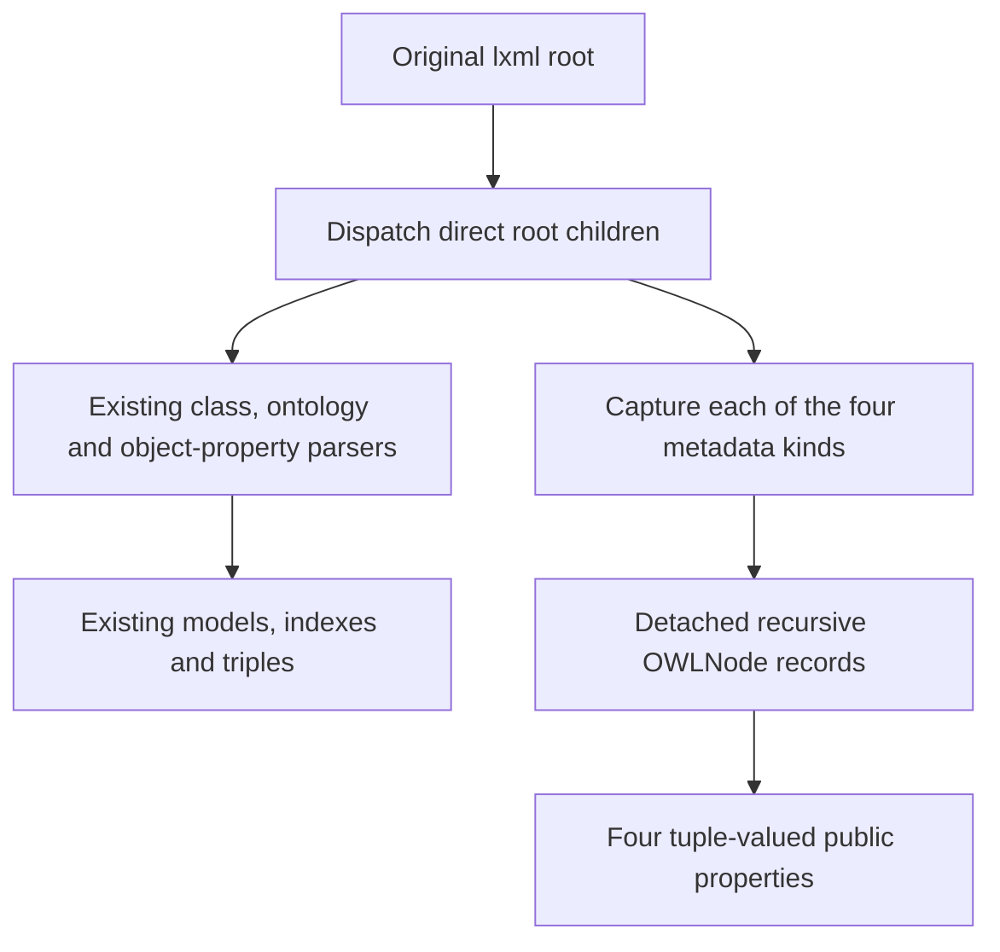
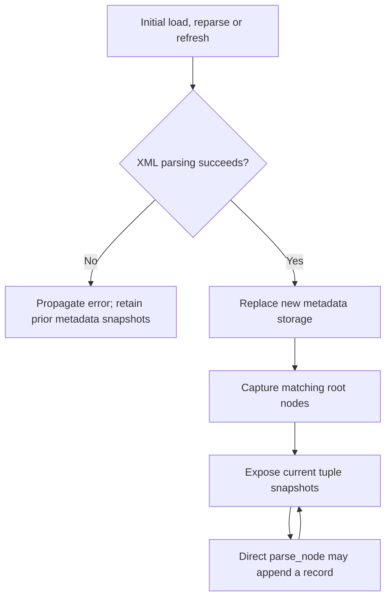

# Resolve fp-10 parser node types - Plan

## Goal Capsule

- **Objective:** Downstream FOLIO callers can inspect the ontology metadata currently hidden behind four unfinished parser branches.
- **Means:** Add separate, read-only structural records for the four node types, following KTD1–KTD3.
- **Authority:** The controller's `fp-10` hygiene mandate and standing rules, then `CLAUDE.md` and `CONTRIBUTING.md`. Campaign authority is the chief repository's `docs/plans/2026-10-26-0705-feat-codex-drawdown-campaign-plan.md`, Goal Capsule and campaign R11, R15, R16, R17, R19, R20.
- **Source limitation:** The chief repository, campaign plan, and `ops/drawdown/mandates/_common.md` are unavailable in this lane. Their text has not been read; campaign references here derive from the supplied standing rules. The controller must supply those excerpts before campaign acceptance.
- **Delivery:** One item on `drawdown/fp-10`, delivered in one PR. This stage commits only this plan. The build stage runs `lfg` on it; the controller scans, pushes, and opens the PR, and the campaign gate owns merging under R6.
- **Stop conditions:** Respect R7 and report a genuine unavailable prerequisite under campaign R20. A failed or unavailable check is never a pass.

---

## Product Contract

### Summary

Resolve all four `FOLIO.parse_node()` placeholders using the published ontology inventory. Expose the types present in that inventory through read-only collections while preserving the existing class, object-property, search, and triple interfaces.

### Problem Frame

The parser silently ignores datatype properties, annotation properties, named individuals, and RDF descriptions. All four occur in the ontology that the suite loads, including repeated definitions and nested restrictions. Callers currently have to interpret the mutable XML tree themselves to inspect this data.

### Requirements

These R-IDs are local to this plan; **campaign R…** identifies the controller's external rules.

**Parsing and compatibility**

- R1. Count each of the four node types in the published OWL used by the suite and record the source identity and counts before implementation.
- R2. Parse every used type into an existing or minimal new read-only structure reachable by a caller, with tests. For a type absent from the measured ontology, replace its placeholder with `LOGGER.debug` naming the skipped type and test successful parsing.
- R3. Remove every `TODO` from `parse_node()` without changing existing public attributes or their contents; assert identical parsed class and object-property counts before and after.
- R4. Keep every existing test and assertion, and add coverage for the new parsing and caller access; never delete, skip, or weaken a test.

**Verification and delivery**

- R5. Pass the repository's full suite and required lint, format, and type checks, with separate reporting of external failures.
- R6. Work only on `fp-10` and commit locally on `drawdown/fp-10`; do not add a remote, find credentials, push, or open a PR from this clone (campaign R15, R17, R19).
- R7. Exclude PyPI publishing, version bumps, migrations, data rewrites, new outside services, spend, credential/security changes, sends in the user's voice, unbacked deletion, and force-push. Never read the prohibited secret or credential files (campaign R11).

### Key Decisions

- **Complete the assigned hygiene item.** Governs R6. (session-settled: user-directed — chosen over speculative features after the ordered work: durable hygiene is the campaign's remaining-work policy.)
- **Use the campaign gate for delivery.** Governs R4–R7. (session-settled: user-directed — chosen over holding guarded work for personal review: the campaign controller and merge gate own publication and acceptance.)

### Scope Boundaries

The active scope is parser dispatch, the minimum public read-only representation, additive tests, and concise API documentation. No front-end page changes are involved, so no screenshot is required.

Considered and not built: RDF reasoning, subject merging, new search indexes, and XML round-trip serialization. The structural records satisfy R2 without these mechanisms; an explicit downstream query or serialization requirement would justify separate work.

#### Deferred to Follow-Up Work

`refresh()` currently leaves object-property collections and indexes uncleared. Fixing that changes existing behavior and is outside R3. Do not disguise it with a new whole-graph refresh invariant or weaken existing tests to accommodate it.

`CONTRIBUTING.md` also calls for public API documentation in the separate `openlegalstandard.org` repository. The controller should carry the README's new API description to its existing library reference page; this lane edits only folio-python.

---

## Planning Contract

### Verified Starting State and Ontology Census

The clean starting branch is `drawdown/fp-10` at `3290e083feb6d6ba0e836d2c4dc6f9d508c425bb`. The local `main` ref is older (`35814e6e405c3a17d7a2240d8ea0efe7b4179461`); preserve the controller-provided branch rather than resetting it to that stale ref. Package version is already `0.4.2` and remains unchanged.

`folio/graph.py:FOLIO.parse_node()` still contains exactly the four target TODO/pass branches. `tests/test_folio.py:folio_graph` constructs the default `FOLIO()`, whose configuration selects `alea-institute/FOLIO`, ref `2.0.0`. The same module also loads ontology `main` through HTTP.

Both published files were fetched on 2026-11-21 at approximately 08:00 UTC and inspected with the standard-library XML parser, without importing FOLIO or running tests. Counts below describe direct children of `rdf:RDF`, the depth dispatched by `parse_owl()`; counts across all element depths were identical for these six types.

| Element type | Default `2.0.0` | HTTP `main` | Planning consequence |
|---|---:|---:|---|
| `owl:DatatypeProperty` | 7 | 7 | Parse and expose |
| `owl:AnnotationProperty` | 25 | 25 | Parse and expose |
| `owl:NamedIndividual` | 30 | 30 | Parse and expose |
| `rdf:Description` | 11 | 11 | Parse and expose |
| `owl:Class` | 18,324 | 18,327 | Preserve current acceptance rules |
| `owl:ObjectProperty` | 181 | 181 | Preserve current acceptance rules |

Sources and byte identities:

- [Default FOLIO OWL](https://raw.githubusercontent.com/alea-institute/FOLIO/2.0.0/FOLIO.owl): 18,292,334 bytes; SHA-256 `b6ed82e6d17b7cb1d468453e4111ec08ca091d72a6849be2b58dd37692cb6ef9`.
- [HTTP main FOLIO OWL](https://raw.githubusercontent.com/alea-institute/FOLIO/main/FOLIO.owl): 18,335,854 bytes; SHA-256 `44657b4ed844f5f9c9c48869184606b4fc671471a8263d79d241de87809fa239`.

All 73 target root nodes in the default file have `rdf:about`. Three annotation-property subjects also appear as object-property declarations, and four RDF-description subjects do likewise. Named individuals contain nine nested predicate subtrees, including `owl:Restriction`, and five individuals repeat predicates. Three descriptions repeat predicates. Some property declarations have no label.

Raw element counts are not parsed model counts. Applying the current IRI/label checks statically predicts **18,323 classes and 175 object properties** for `2.0.0`, and **18,326 classes and 175 object properties** for `main`; the `owl:Thing` exception is included. These are predictions, not executed parser results. U1 must measure the actual unchanged parser on saved identical bytes before implementation and retain that baseline for U3.

### Existing Behavior Trace

`FOLIO.__init__()` initializes graph state, loads OWL, and calls `parse_owl()`. That method creates an lxml tree with comments removed, dispatches direct root children, and then builds class edges, cached triples, ranking metadata, and prefix indexes. `_build_prefix_rank_bonus()` reads the original tree, so production parsing must not remove or replace nodes to create the new view.

`parse_owl_class()` and `parse_owl_object_property()` populate mutable Pydantic models, triples, and existing indexes. Their validation and side effects stay intact. Class lookups and `get_property()` retain their respective model types. Unknown root types retain their existing debug logging. Loader and XML errors continue to propagate.

`refresh()` reloads through `parse_owl()` after clearing some legacy state. New metadata must refresh correctly without expanding that method into a repair of existing object-property behavior.

### Key Technical Decisions

- KTD1. **Use one immutable structural node model.** Add `OWLNode` in `folio/models.py`, re-exported through `folio/__init__.py`. A frozen standard-library dataclass holds an expanded `tag`, immutable attribute pairs, optional `text` and `tail`, and ordered tuple `children`; a convenience `iri` reads `rdf:about` or returns `None`. Capture detached values recursively, including unlabeled declarations and nested restrictions. The snapshot contains XML element children only. Skip non-element children such as processing instructions, folding their tail text into the preceding captured child's tail or the parent's text when there is no preceding child. Preserve the source tree. This is smaller than four models or a new RDF engine and avoids opaque serialized XML that callers must reparse. Frozen instances reject ordinary field assignment; immutable nested containers are also necessary ([Python 3.10 dataclasses](https://docs.python.org/3.10/library/dataclasses.html#frozen-instances)). Governs the implementation of R2.
- KTD2. **Expose four separate collections.** Add getter-only `datatype_properties`, `annotation_properties`, `named_individuals`, and `rdf_descriptions` properties returning tuples of `OWLNode`. Back them with private per-instance storage. Preserve document order and repeated subjects; do not use an IRI-keyed map or merge metadata into any existing model, index, edge, or triple collection. Each matching root dispatch captures one record; recursive capture never redispatches nested nodes. This keeps R3 intact while satisfying R2.
- KTD3. **Replace new state on successful document parsing.** Initialize the new storage before the constructor's first parse. Rebuild it after XML parsing succeeds on each `parse_owl()` call, including calls through `refresh()`. A direct `parse_node()` call appends one record and still returns `None`. An XML syntax failure leaves previous new-node snapshots intact; do not promise transactional rollback for legacy graph state. Tuples already held by callers remain unchanged after reparsing or source-tree mutation. Applies R2 without changing the legacy lifecycle under R3.
- KTD4. **Prove compatibility on identical input.** Capture actual pre-change class/property counts and complete model snapshots, indexes, class edges, title/description, and triples. Compare the same bytes after implementation. Add independent full-versus-filtered tests that remove only the four target root types from a copied test document and compare fresh graphs' legacy contents. This second proof detects metadata-dispatch side effects but does not substitute for the historical baseline. The original production tree remains intact. Implements R3–R5.
- KTD5. **Keep campaign model routing.** (session-settled: user-directed — chosen over the Sol-first ladder: local work uses Astra; cloud builds use the cloud default model, with Astra and Fable reviews at the campaign gate.) The lane's `cross_model_review_mode: off` does not establish that those later reviews ran.

### High-Level Technical Design

Public data access and parsing separation, under KTD1–KTD2:

New collection lifecycle, under KTD3:

### Assumptions and Risks

- The minimal caller need is structural inspection, not semantic RDF inference. The public view preserves parsed names, attributes, text/tail, order, and nesting; it does not promise original namespace-prefix spelling, inherited XML context, or byte-for-byte round trips.
- The existing ontology refs can move. Recount and identify the bytes used for the build baseline; never compare counts from different downloads or silently change an expectation after a failure.
- A frozen model alone does not freeze nested lists or lxml objects. Tests must exercise nested mutation and independence from the source tree, not only top-level assignment.
- Campaign excerpts are a controller context dependency, not a credential request or a decision for Damien. Full-suite network results remain execution-time evidence.

---

## Implementation Units

### U1. Establish parser compatibility baselines

**Goal:** Capture the unchanged parser's output before adding metadata handling.

**Requirements:** R1, R3–R5. **Dependencies:** None.

**Files:** Add characterization coverage in `tests/test_parser_node_types.py`; add published-input count assertions in `tests/test_folio.py`; create `docs/plans/evidence/fp-10-parser-node-types.md` for baseline and final evidence.

**Approach:** Follow KTD4 and the `local_graph` fixture in `tests/conftest.py`. Retain a build-local copy of the exact published XML for before/after measurements, recording its digest and numeric results in the receipt. Do not commit the full OWL download. Use independently constructed fresh graphs for the comparison, and disable optional LLM construction for new local tests.

**Execution note:** Add characterization coverage and record the actual full-suite baseline before changing production parsing.

**Test scenarios:**

1. A tiny document with known classes and an object property yields exact counts and complete expected model/index/triple contents.
2. Adding the four metadata kinds, including a description sharing an existing subject, leaves those legacy contents identical to a metadata-free control.
3. The published input's accepted class/property counts match an independently enumerated baseline; distinguish rejected unlabeled declarations from raw root totals.

**Verification:** Baseline numbers and source identity are recorded before U2. Local fixtures prove parser isolation; the published test covers real ontology shape and does not prove network availability on every later run.

### U2. Expose immutable records for all four used types

**Goal:** Make the previously ignored metadata reachable through the public library.

**Requirements:** R2–R4. **Dependencies:** U1.

**Files:** `folio/models.py`, `folio/graph.py`, `folio/__init__.py`, and `tests/test_parser_node_types.py`.

**Approach:** Implement KTD1–KTD3 with one recursive capture helper shared by the four branches. Keep existing class/property parsers and indexes unchanged. Update the parser docstring to describe the new records. R2's absent-type debug branch is not selected: all four measured counts are nonzero.

**Patterns to follow:** Existing `NSMAP`/`get_ns_tag()` dispatch, package re-exports, and the `local_graph` constructor seam. The new model must support Python 3.10 and use no optional dependency.

**Test scenarios:**

1. Each target type produces a publicly accessible `OWLNode`; an empty document produces four empty tuples.
2. Unlabeled nodes, nodes without `rdf:about`, same-kind duplicate subjects, and cross-kind shared subjects remain separate records with their original attributes.
3. Repeated definitions and language-tagged literals retain order and text; resource IRIs and datatype attributes remain distinguishable. Mixed literal text around a processing instruction remains complete under KTD1, with element-only snapshot children and an unchanged source tree.
4. A named individual containing nested restrictions remains navigable, without adding nested elements to the root collections.
5. Collection reassignment, record assignment, and nested mutation fail through the supported interface; changing the original lxml node cannot alter the snapshot.
6. A successful reparse/refresh replaces all four metadata collections with records from the new document, and a retained prior tuple stays unchanged. A malformed second parse raises and preserves the prior metadata snapshots. These assertions do not constrain the existing refresh behavior of legacy fields.
7. Direct `parse_node()` appends the matching record, returns `None`, and leaves legacy contents unchanged; unknown root types keep their existing logging behavior.

**Verification:** All four TODOs are gone and every record is reachable without parsing XML again. These local tests prove behavior offline, not published-input counts.

### U3. Verify published compatibility and document caller access

**Goal:** Demonstrate preserved library behavior and explain the new public view.

**Requirements:** R3–R7. **Dependencies:** U1, U2.

**Files:** `tests/test_folio.py`, `tests/test_core_install.py`, `tests/test_parser_node_types.py`, `README.md`, `CHANGES.md`, and `docs/plans/evidence/fp-10-parser-node-types.md`.

**Approach:** Complete KTD4's comparison using the same saved bytes and independently populated graphs. Add a core-only installed-wheel probe following `tests/test_core_install.py` without altering existing probes. Document the four accessors, immutable structural fields, and preservation boundary; add an `Unreleased` changelog bullet. Test the README's small caller-access path through the existing local fixture.

**Test scenarios:**

1. Published-input class/property counts and full legacy snapshots are identical to U1's baseline, while the four new tuple lengths match the raw inventory.
2. Full-versus-filtered published documents produce identical old models, indexes, edges, title/description, and triples. Do not compare their intentionally different source trees.
3. The isolated installed wheel imports the public model and reads metadata through an accessor without search extras, a network request, or an API key.
4. The documented local usage retrieves a record's IRI and a child's literal value; original parsing, search, query, and benchmark tests continue unchanged.

**Verification:** The full suite and repository checks pass, with source hashes, actual counts, outcomes, and limitations retained in the receipt. The controller receives local commits under R6; publication and releases remain governed by R6–R7.

---

## Verification Contract

No application tests run during this planning stage. The following are build-stage gates, using the locked setup in `CLAUDE.md` and the separate core-only installation in `CONTRIBUTING.md`.

| Gate | Repository command or evidence | Required result |
|---|---|---|
| Parser cases | `uv run --frozen pytest tests/test_parser_node_types.py tests/test_parser_hygiene.py tests/test_models.py` | All new and existing parser/model cases pass |
| Published compatibility | `uv run --frozen pytest tests/test_folio.py` plus identical-byte before/after snapshots | Actual class/property counts and legacy contents unchanged |
| Core-only wheel | `uv run --frozen pytest tests/test_core_install.py` with `FOLIO_CORE_PYTHON` configured | New and existing isolated probes execute and pass |
| Full suite | `uv run --frozen pytest tests/` with the same core-only interpreter configured | No existing tests weakened or newly skipped; all tests pass, including benchmarks |
| Lint | `uv run --frozen ruff check folio/ tests/` | No diagnostics |
| Formatting | `uv run --frozen ruff format --check folio/ tests/` | No formatting changes required |
| Types | `uv run --frozen ty check folio/` | Zero diagnostics with the configured Python 3.10 target |

Keep the existing deterministic coverage gate in `.github/workflows/hygiene.yml` passing. Network-dependent ontology or branch-list failures must be identified separately and rerun in the controller's authorized environment; they do not count as full-suite success. No browser is involved. Do not modify publishing configuration or package versions to complete verification.

---

## Definition of Done

- R1's inventory is recorded and the build receipt contains actual pre-change and post-change parser counts for identical bytes.
- U1–U3 pass their verification, including public reachability, immutable nested content, and compatibility assertions.
- No TODO remains in `parse_node()`; unrelated TODOs and legacy behavior stay outside this item.
- Existing tests retain all assertions, and the full suite and static checks pass under R4–R5.
- README documentation and an `Unreleased` bullet describe the new structural view without claiming RDF reasoning or serialization support.
- The final diff contains only fp-10 work, with no abandoned experimental code, version change, publishing change, or prohibited material.
- The plan and later build commits remain on `drawdown/fp-10` for controller-owned delivery under R6; the controller supplies the unavailable campaign excerpts before campaign acceptance.
